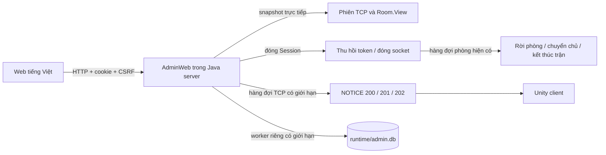

# Website quản trị kết nối Tank Battle

Nếu mới clone hoặc tải ZIP từ GitHub, bắt đầu từ [README chính](README.md). Các lệnh dưới đây chạy ở gốc repository branch tung, nơi có source, scripts, config và README.md. Source không kèm file chạy, database hay mật khẩu.

Website nằm trong server Java, chạy cục bộ tại **http://127.0.0.1:8080**. Dữ liệu đến từ socket thật của game. Không cần Node.js, dịch vụ web riêng hay database trên máy người chơi.

Nền game đã đồng bộ branch Bao commit `ec3221e` (v1.0.3), protocol **16**, content **7**. Dùng client tương ứng; không đổi riêng số protocol để ép client cũ kết nối. Khi cập nhật source, dừng server bằng Ctrl+C, chạy `scripts\build-server.cmd`, rồi `scripts\start-server.cmd`; tài khoản và lịch sử trong runtime được giữ lại.

## Khởi chạy trên Windows

Chọn branch tung khi clone/tải ZIP theo README. Mở thư mục gốc đã giải nén (nơi có source, scripts, config), gõ `cmd` vào thanh địa chỉ File Explorer. Không chạy `cd Tank_Game_updated`; repository này không có folder đó. Bản tải từ GitHub cần build trước. Nếu đã có `build\server\tank-server-1.0.0.jar`, chỉ cần JDK 21 để chạy. Chỉ khi build lại source mới cần thêm Maven 3.9 và Python 3.

```cmd
rem Chi build neu chua co JAR hoac vua sua source
scripts\build-server.cmd
rem Dung server truoc khi khoi tao hoac doi mat khau admin.
scripts\init-admin.cmd -Name admin
scripts\start-server.cmd
```

Chỉ khi đã nhận JAR tương thích qua kênh riêng và đặt đúng đường dẫn, có thể bỏ qua build. Sau đó tạo admin và chạy:

```cmd
scripts\init-admin.cmd -Name admin
scripts\start-server.cmd
```

Chỉ chạy `init-admin.cmd` khi khởi tạo admin lần đầu hoặc muốn đặt lại mật khẩu. Những lần mở server sau chỉ cần `scripts\start-server.cmd`.

Mở website từ CMD:

```cmd
start "" "http://127.0.0.1:8080"
```

Giữ cửa sổ server mở, dùng một cửa sổ CMD khác để mở website hoặc chạy client. Dừng server bằng Ctrl+C trước khi đặt lại mật khẩu. Lệnh khởi tạo luôn dùng `config\server.properties`; nếu dùng cấu hình riêng, truyền cùng `-Config` cho cả khởi tạo và chạy server:

```cmd
scripts\init-admin.cmd -Name admin -Config "config\server.local.properties"
scripts\start-server.cmd -Config "config\server.local.properties"
```

Các file `.cmd` gọi lại script `.ps1` có sẵn bằng Windows PowerShell tích hợp trong Windows. Bạn thao tác hoàn toàn từ CMD; không cần mở PowerShell hoặc đổi Execution Policy của hệ thống.

Lệnh khởi tạo yêu cầu nhập và xác nhận mật khẩu tối thiểu 12 ký tự; mật khẩu không hiển thị. Sau đó mở http://127.0.0.1:8080 và đăng nhập với tài khoản vừa tạo. Không có mật khẩu mặc định. Chạy lại lệnh khởi tạo khi server đã dừng để đặt lại mật khẩu.

Nếu terminal không hỗ trợ nhập mật khẩu Java, có thể truyền bí mật qua biến môi trường `TANK_ADMIN_PASSWORD` chỉ cho tiến trình khởi tạo; xóa biến sau khi dùng. Không đặt mật khẩu trong file cấu hình hay đối số dòng lệnh.

Lệnh Java tương đương:

```cmd
java -cp "build\server\tank-server-1.0.0.jar" tank.AdminSetup config/server.properties admin
java -jar "build\server\tank-server-1.0.0.jar" config/server.properties
```

Cấu hình trong `config/server.properties`:

```properties
admin.enabled=true
admin.bind=127.0.0.1
admin.port=8080
admin.database.path=runtime/admin.db
admin.session.minutes=60
```

Giữ `admin.bind=127.0.0.1` cho bài tập; cổng web phải khác TCP 8888. HTTP không có TLS và được thiết kế cho quản trị trên máy server. API quản trị không được mở ra Internet. Tắt web bằng `admin.enabled=false` nếu cần chạy game riêng.

## Test bằng client Unity

Chỉ sau khi build client hoặc nhận đủ folder client chạy sẵn, mở trong một CMD khác tại gốc repository:

```cmd
start "" "build\client\TankBattle.exe"
```

Nếu folder client ở nơi khác, thay đường dẫn tới file `TankBattle.exe`. Nhập server `127.0.0.1`, TCP `8888`, UDP `8889` khi chạy cùng máy; nếu ở máy khác thì dùng IP LAN/Radmin của máy server. Web sẽ thấy phiên kết nối và tên tài khoản sau khi đăng nhập game. Cần hai client với hai tài khoản để bắt đầu trận.

Nếu chỉ có project Unity, mở `source\client` bằng Unity Hub, vào scene `Assets/Scenes/Main.unity` và bấm Play, hoặc đóng Editor rồi build bằng:

```cmd
scripts\build-client.cmd
```

## Thao tác trên web

- **Kết nối trực tiếp:** số phiên, IP, tài khoản đăng nhập, người trong trận và IP bị ban; tìm kiếm, lọc, phân trang 12 phiên. Mỗi dòng có mã phiên và cổng nguồn để phân biệt nhiều client cùng IP. Xem thời điểm kết nối/hoạt động, trạng thái phòng/trận, TCP và hoạt động UDP. Dữ liệu tự cập nhật mỗi 2 giây, báo cũ sau 7 giây không cập nhật thành công. Không giả lập RTT.
- **Quy tắc ban IP:** thêm IP và lý do, sửa lý do, kích hoạt/tạm dừng, xóa để bỏ ban. IP đích không đổi khi sửa. Hộp xác nhận nêu IP, tài khoản và số phiên bị ảnh hưởng. IPv4/IPv6 cụ thể được chuẩn hóa; không nhận hostname hay CIDR.
- **Ngắt IP:** đóng mọi kết nối đang dùng IP đó, có xác nhận số kết nối/tài khoản và lý do. Không tạo ban; người chơi được phép kết nối lại. Giao diện bỏ nút ngắt riêng một phiên để tránh nhầm lẫn.
- **Lịch sử:** bấm IP/tài khoản để tra cứu các giai đoạn đăng nhập, IP liên quan, tài khoản liên quan, lần đầu/cuối và lý do kết thúc. Dùng bộ lọc ngày theo múi giờ Việt Nam. Bảng phân trang 50 bản ghi; phần tổng hợp tối đa 100 cặp gần nhất. Tra IP đó trong mục quy tắc và nhật ký để xem thao tác liên quan.
- **Thông báo:** chỉ chọn **Tất cả người chơi** hoặc **Một IP**; chọn thông tin/cảnh báo/lỗi. Nút Gửi tin trên mỗi dòng tự điền IP. Tất cả gồm mọi kết nối TCP đang mở, kể cả chưa đăng nhập; Một IP gồm mọi kết nối cùng địa chỉ đó. Nhiều người chung IP sẽ cùng nhận tin. Giới hạn 500 ký tự và 1.000 byte UTF-8. Kết quả là số kết nối đã đưa vào hàng đợi gửi, không phải số người đọc.
- **Nhật ký:** tìm theo IP, tài khoản, admin, nội dung, loại thao tác và khoảng ngày. Ghi yêu cầu và kết quả thao tác ngắt/gửi riêng để không nhầm đã tiếp nhận với đã thực hiện.

Client Unity cần build lại để có hộp nổi thông báo admin ở giữa màn hình, cả trong menu và trận. Hộp dùng panel tối, màu vàng/xanh và kiểu chữ CartoonUi/MenuTheme của bản 1.0.3, phân biệt thông tin/cảnh báo/lỗi bằng màu, có vùng cuộn cho tin dài và nút Đóng hoặc Tin tiếp theo. Tin admin không còn đẩy vào dòng trạng thái chung ở góc. Nhiều tin được giữ theo thứ tự; tối đa 32 tin kể cả tin đang xem. Khi quá tải, giữ nguyên tin đang xem, bỏ tin chờ cũ nhất và hiện số tin đã lược bớt. Hộp không tạm dừng trận, thay đổi điều khiển, tự ngắt kết nối hoặc gửi xác nhận đã đọc. Client cũ chỉ có cách hiển thị đã được build sẵn; cập nhật web đơn lẻ không thay đổi được giao diện của client cũ.

## Kiến trúc phục vụ báo cáo

Các khái niệm ở giao diện cũ: client là ứng dụng game trên máy người chơi; phiên là một lần client kết nối TCP tới server (kết nối lại tạo phiên mới). Gửi theo phiên chỉ đến một kết nối; theo IP đến mọi kết nối chung IP; theo phòng đến các thành viên phòng đó; toàn bộ đến mọi kết nối. Giao diện hiện chỉ giữ IP và toàn bộ cho dễ dùng. API cũ theo phiên/phòng vẫn được giữ tương thích với các tích hợp và kiểm thử hiện có.

Để nhìn thấy popup mới, mở đúng project `source\client` trong repository này bằng Unity **6000.3.24f1** và bấm Play, hoặc chạy `scripts\build-client.cmd` rồi mở `build\client\TankBattle.exe`. Cần cài module Windows Build Support khi build. Giữ nguyên toàn bộ folder build/client khi gửi cho người chơi. Launcher đang trỏ bản phát hành cũ sẽ tiếp tục tải client cũ cho đến khi nhóm phát hành bản client tích hợp mới. Popup có nền tối phủ phía sau, luôn nằm trên menu/HUD; không phụ thuộc việc người chơi ở sảnh, trận multiplayer hay chiến dịch.



`AdminWeb` dùng HTTP server có sẵn của JDK. Giao diện HTML/CSS/JS thuần được đóng gói trong JAR. Gson đã có trong dự án được dùng cho API web; giao thức game vẫn là nhị phân big-endian hiện có.

`SYSTEM_PROMPT.md` mô tả thiết kế cũ có header 8 byte. Source hiện tại thực tế dùng header **12 byte**, magic `0x5442`, version 16 (GameRules.ProtocolVersion) và token game 16 byte. Phần quản trị và kiểm thử đi theo `Protocol.java`/`Protocol.cs` hiện tại, không xây dựng lại game theo bản mô tả cũ.

Mỗi kết nối TCP có UUID, IP quan sát từ socket và thời gian kết nối. Khi kết nối, đăng nhập, đăng xuất hoặc đóng phiên, server đẩy sự kiện lịch sử vào worker riêng. Mỗi thay đổi danh tính đóng một giai đoạn cũ và mở giai đoạn mới, giữ đầy đủ quan hệ nhiều IP–nhiều tài khoản. Khi server khởi động lại, các giai đoạn còn mở được đánh dấu kết thúc do server khởi động lại.

Ban được ghi cùng nhật ký trong một transaction SQLite, cập nhật tập IP bị chặn rồi đóng mọi phiên cùng IP. Khóa điều phối chung với luồng accept ngăn lọt phiên mới giữa bước kiểm tra ban và đăng ký kết nối. Quy tắc ban được nạp trước khi bắt đầu accept. Không kiểm tra cổng nguồn để quyết định ban.

Đóng phiên dùng đường đi có sẵn: đánh dấu phiên đóng, thu hồi token/endpoint, đóng TCP và đưa lệnh rời phòng vào hàng đợi. Vòng tick cũng thu dọn phiên đóng nếu hàng đợi đầy. Game tự cập nhật chủ phòng, thành viên và kết quả theo luật hiện có. Input đã xếp hàng của phiên đóng bị bỏ qua; token bị thu hồi nên UDP mới không được định tuyến. HTTP không sửa physics, điểm, máu hoặc danh sách thành viên phòng. Phản hồi ngắt xác nhận socket đã đóng; việc cập nhật phòng được xử lý ở tick kế tiếp.

`runtime/admin.db` độc lập với `runtime/tank.db`, chứa admin riêng (PBKDF2-HMAC-SHA256, 600.000 vòng và salt ngẫu nhiên), quy tắc ban, lịch sử và audit. Phiên web ngẫu nhiên 256 bit nằm trong RAM, cookie HttpOnly/SameSite=Strict, hết hạn tuyệt đối và bị thu hồi khi đăng xuất/restart. API thay đổi dữ liệu yêu cầu JSON và CSRF token; Origin được kiểm tra khi có. Đăng nhập có giới hạn tốc độ. Không xuất mật khẩu, hash hay token game qua API.

HTTP có 4 worker/hàng đợi 64; lưu trữ có 1 worker/hàng đợi 2.048. Không ghi database trên tick. Khi quá tải hoặc lỗi dữ liệu, API trả lỗi và bộ đếm `storageFailures` cảnh báo lịch sử có thể thiếu. Sự kiện lịch sử không có spool bền vững khi hàng đợi quá tải; cần giải quyết nguyên nhân trước khi tiếp tục vận hành. Thao tác ban chỉ thực thi sau khi lưu thành công. Truy vấn trang web không dùng worker database tài khoản game.

Sao lưu cả `runtime/admin.db` và `runtime/tank.db` khi server dừng. Các file database/build/runtime được gitignore, không đưa mật khẩu hoặc dữ liệu người chơi vào repository.

## Kiểm thử

```cmd
mvn -f source/server/pom.xml test
node --check source/server/src/main/resources/admin/app.js
```

`AdminWebTest` dùng HTTP thật, SQLite tạm, socket TCP thật và giao thức game nhị phân. Kiểm tra quyền admin, CSRF, dữ liệu đầu vào, nhiều tài khoản cùng IP, các phạm vi thông báo, kick riêng/kick IP, ban cả phiên chưa đăng nhập, IP khác không bị ảnh hưởng, khôi phục ban/lịch sử sau restart và bỏ ban cho phép kết nối lại.

Để nghiệm thu bằng Unity: build lại client, mở 2 client cùng IP, đăng ký hai tài khoản và đăng nhập, tạo/join phòng rồi bắt đầu trận. Kiểm tra trạng thái web chuyển qua phòng chờ/chuẩn bị/đang chơi/kết quả. Gửi thông báo từng phạm vi và kiểm tra khung hiện trong trận; kick chủ phòng rồi kiểm tra chuyển chủ/kết quả; ban IP để cả hai bị ngắt. Restart server để kiểm tra lịch sử/quy tắc còn nguyên, sau đó bỏ ban và kết nối lại.

Kết quả và giới hạn kiểm chứng được ghi trong [ADMIN_VALIDATION.md](ADMIN_VALIDATION.md). Không dùng IP làm bằng chứng duy nhất xác định một người hoặc hành vi gian lận.

## Build và khởi động lại sau cập nhật

Client/server phải cùng phiên bản giao thức (source hiện tại v16, nội dung Nhập vai v7). Giữ phần quản trị khi cập nhật source; chỉ giữ các file AdminWeb/AdminStore riêng lẻ là chưa đủ.

Sau END, server chuyển phòng về WAITING ngay để chơi trận tiếp theo. Web hiện “Trong phòng chờ” dù client còn xem bảng kết quả; đây là trạng thái thật của server.

Khi sửa Java hoặc tài nguyên web đóng gói, dừng server cũ bằng Ctrl+C, build rồi mở lại:

```cmd
scripts\build-server.cmd
scripts\start-server.cmd
```

Khi sửa C#, giao thức hoặc nội dung chung, build lại client (đóng Editor trước) hoặc chờ Unity biên dịch lại rồi Play:

```cmd
scripts\build-client.cmd
```

Không cần khởi tạo lại admin sau mỗi lần build/start. Dùng cùng config/database để giữ dữ liệu. Cấu hình demo không bật web mặc định; người tải mới nên dùng server.properties theo hướng dẫn.

## Hộp thông báo mạng và tích hợp khi cập nhật game

Luồng thông báo hiện tại:

```text
Web → AdminWeb → TCP NOTICE (200/201/202)
    → ClientCore.Messages → AdminNoticeChannel
    → AdminNoticeQueue → AdminNoticeOverlay
```

`AdminNotices.cs` chứa kênh nhận và hàng đợi thuần C#; `AdminNoticeOverlay.cs` tự khởi tạo khi vào game và tồn tại qua chuyển scene. Overlay đọc MenuTheme để theo giao diện game. Chỉ các NOTICE 200/201/202 đi vào hộp; NOTICE AFK 100/101 và các thông báo của game giữ luồng cũ. Đã gỡ khung admin cũ do phần web thêm trong TankApp; không thay các hàm cập nhật trận, input, physics, kỹ năng, điểm số hoặc nội dung game.

Khi chép source game mới, giữ hai file trên cùng `.meta` và lời gọi `AdminNoticeChannel.Publish` trong handler NOTICE của client. Nếu game thay MenuTheme hoặc đổi giao thức, cần điều chỉnh adapter/overlay và kiểm thử lại; không thể bảo đảm tương thích với mọi thay đổi source tùy ý.

Các script build server/client và test client chạy kiểm tra có mặt các điểm tích hợp trước khi tiếp tục. Có thể chạy thủ công từ CMD:

```cmd
python scripts\check-admin-integration.py
```

Các script kiểm tra dùng Python 3; khi build/test client bằng script cần Python trong PATH ngoài Unity Editor. Chơi bản client EXE hoặc mở/Play trong Unity không yêu cầu Python.

Kiểm tra này chỉ đọc file và báo thiếu hook; không sửa gameplay, không thay thế kiểm thử giao thức hay Unity. Sau cập nhật server, chạy kiểm thử Java; sau cập nhật client, chạy test Unity và nghiệm thu hộp trong menu/trận. Nếu chép đè cả thư mục scripts thì cũng phải giữ script kiểm tra và các lệnh gọi nó.

Khi chỉ sửa hộp nổi trong C# và không đổi giao thức, chỉ cần build lại client; không cần build hay restart server vì không đổi API/giao thức/JAR:

```cmd
scripts\build-client.cmd
```

Trong Unity Editor, chờ biên dịch lại và Play. Để test: gửi riêng một IP, thử đủ ba loại tin, tin dài có xuống dòng, gửi liên tiếp nhiều tin, đổi menu/vào trận rồi đóng từng tin. Người chơi ở IP khác không thuộc đích gửi sẽ không nhận tin. Web vẫn báo số phiên đã xếp hàng gửi, không báo số người đã đọc hoặc đã đóng hộp.

## Tương thích Launcher 1.0.3

Server này lấy toàn bộ nền game từ tag v1.0.3 (protocol 16, content 7), không chỉ thay số version trên server v5. Quản trị dùng lại Session, hàng đợi phòng và đường close/logout của server mới; thoát chiến dịch đi qua CampaignSession.close có sẵn. Web nhận thêm trạng thái CAMPAIGN và tính người đang chơi chiến dịch vào tổng người chơi.

Client Launcher 1.0.3 nguyên bản đăng ký, đăng nhập và chơi được, nhưng chỉ có cách hiển thị NOTICE gốc. Muốn hộp nổi admin mới xuất hiện cần build/phát hành client có AdminNoticeOverlay đã ghép theo CartoonUi. Phát hành client/manifest Launcher là thao tác riêng, không tự thực hiện khi build server.

Sau khi áp dụng bản cập nhật vào thư mục đang vận hành: dừng server v5 bằng Ctrl+C, build server mới rồi start lại. Tiếp tục dùng runtime/config hiện tại để giữ admin và dữ liệu; không cần khởi tạo admin lại. Source cũ v5 không thể chơi cùng server v16.
