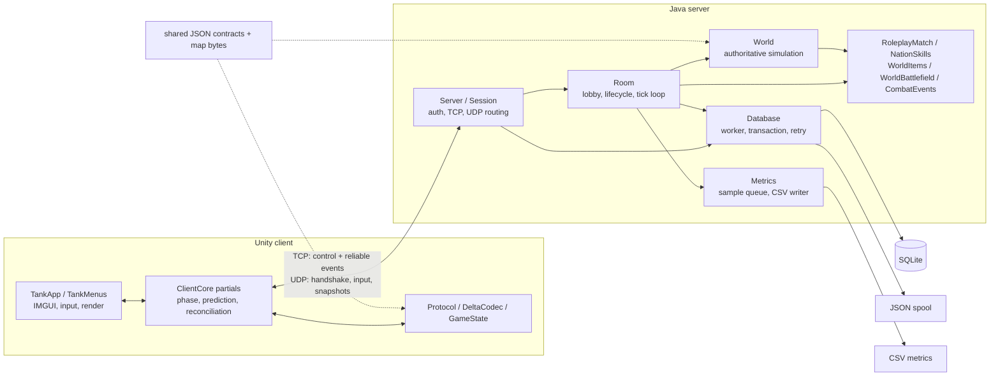
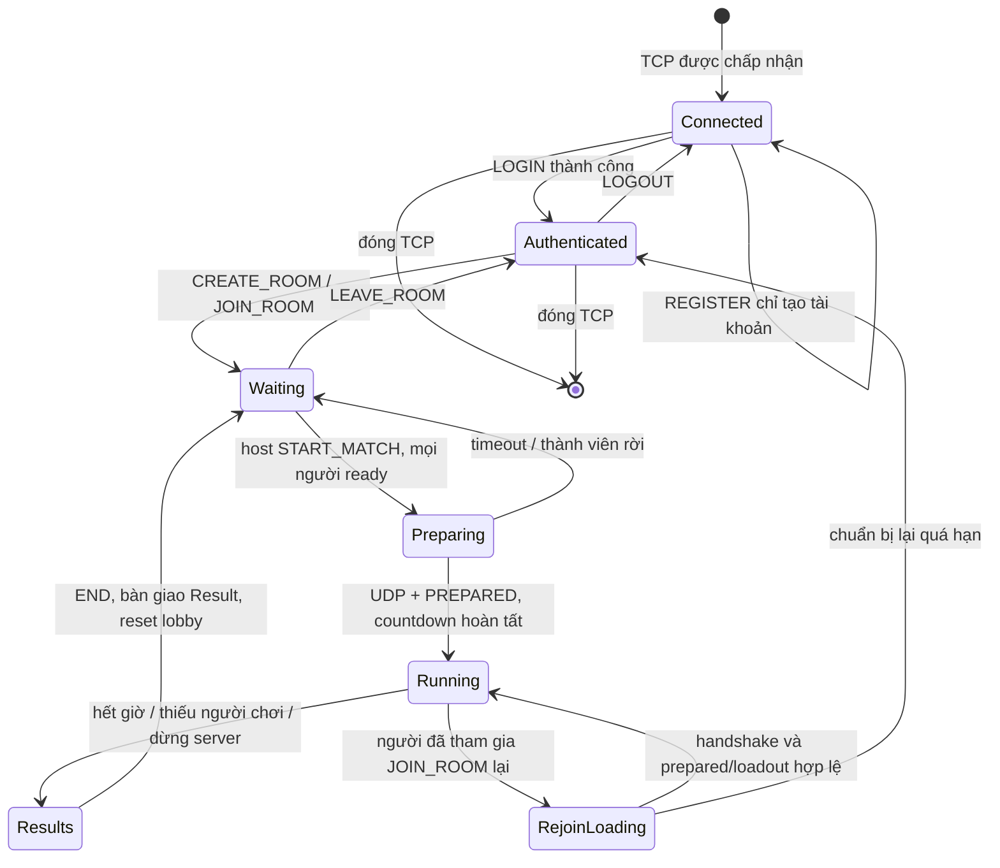

# Kiến trúc hệ thống

Đối chiếu mã nguồn ngày **2026-10-23**, trên nền HEAD `e788610bdb0e2cd9fbd3f0cce54d9d29e815947e` và các thay đổi chưa commit đang có trong working tree. Đây là mô tả tĩnh từ mã nguồn; tác vụ tài liệu này **không chạy build, JUnit, Unity EditMode hay kiểm thử thủ công**. Các test bên dưới là điểm kiểm tra cần đọc/chạy, không phải kết quả đã xác nhận.

Mục lục:

- [Thành phần và trách nhiệm](#components)
- [Khởi động và dừng](#startup)
- [Vòng đời tài khoản, phòng và trận](#lifecycle)
- [Luồng dữ liệu](#data-flow)
- [Đồng thời, hàng đợi và quyền sở hữu](#concurrency)
- [Bản đồ mã nguồn theo tác vụ](#source-map)
- [Giới hạn kiến trúc và phạm vi bằng chứng](#limitations)

Đọc [ngữ cảnh dự án](context.md) trước khi viết phần giới thiệu báo cáo. Chi tiết byte/gói tin nằm ở [giao thức](protocol.md), luật mô phỏng ở [gameplay](gameplay.md), lưu trữ ở [dữ liệu](data.md), giao diện ở [client](client.md), lệnh vận hành ở [triển khai](deployment.md).

<a id="components"></a>
## Thành phần và trách nhiệm

Hệ thống dùng mô hình **client–server, server quyết định trạng thái trận đấu**. Unity nhận thao tác, dự đoán chuyển động xe của mình và dựng hình từ snapshot; Java nhận lệnh, mô phỏng thế giới và phát trạng thái được chấp nhận. SQLite lưu tài khoản, hồ sơ và kết quả, không lưu toàn bộ trạng thái trận đang chạy.



| Thành phần | Trách nhiệm và điểm vào |
| --- | --- |
| [Main.main](../source/server/src/main/java/tank/Main.java) | Đọc cấu hình, nối stdout/stderr vào log, tạo `Server`, đăng ký shutdown hook và gọi `start()`. |
| [Server](../source/server/src/main/java/tank/Server.java), `Server.Session` | Sở hữu socket, danh sách kết nối/tài khoản/token/phòng; phân loại request; đưa thao tác phòng vào hàng đợi. `Session` là một kết nối TCP, không phải tài khoản bền vững. |
| [Room](../source/server/src/main/java/tank/Room.java) | Sở hữu thành viên, chủ phòng, người đã tham gia trận, trạng thái chuẩn bị, world, input và cache snapshot theo người nhận. `tick()` điều phối vòng đời; `World.step()` thực hiện mô phỏng. |
| [World](../source/server/src/main/java/tank/World.java) | Trạng thái xe/đạn/gạch; xử lý chuyển động, va chạm, sát thương và sinh snapshot. Các mô-đun kỹ năng, vật phẩm, chiến trường và combat event bổ sung cho world; xem [gameplay](gameplay.md). |
| [RoleplayMatch](../source/server/src/main/java/tank/RoleplayMatch.java) | Nhánh chuẩn bị/loadout và xử lý yêu cầu kỹ năng tin cậy của chế độ `ROLEPLAY`; thuộc quyền điều phối của room. |
| [Database](../source/server/src/main/java/tank/Database.java) | Xác thực, hồ sơ, lịch sử, ghi kết quả qua worker; transaction SQLite và spool/retry khi ghi thất bại. Xem [persistence](data.md#persistence). |
| [TankApp](../source/client/Assets/Scripts/TankApp.cs) | Bootstrap runtime, nạp map/cấu hình, gọi `ClientCore.Poll()`, lấy input, cập nhật hiệu ứng và vẽ IMGUI/arena. |
| [ClientCore](../source/client/Assets/Scripts/ClientCore.cs) và các partial | `ClientCore.Network.cs`: socket/queue; `ClientCore.Messages.cs`: xử lý message và chuyển phase; `ClientCore.Roleplay.cs`: loadout/kỹ năng. `ClientCore.cs`: vòng poll, snapshot, prediction/reconciliation. |
| [GameState](../source/client/Assets/Scripts/GameState.cs) | Các lớp `GameMap`, `WorldState`, `TankState`, `Movement`, `Rendering`; không có lớp trung tâm tên `GameState`. `Movement.Step()` dự đoán, `Rendering.Interpolate()` dựng trạng thái hiển thị. |
| [Metrics](../source/server/src/main/java/tank/Metrics.java) | Room chụp số đo vào queue; writer riêng định dạng và ghi CSV. Ý nghĩa chỉ số và cách so sánh ở [đánh giá](evaluation.md#metrics). |

`RoomMode` (`NORMAL`/`ROLEPLAY`) chọn nội dung và quy trình chuẩn bị. `NetworkMode` chọn baseline, input redundancy, delta hoặc combined. Đây là hai chiều cấu hình riêng; xem [transport](protocol.md#transport) và [skills](gameplay.md#skills).

<a id="startup"></a>
## Khởi động và dừng

**Server:** `Main.main()` tạo `Config` từ đối số đường dẫn hoặc `config/server.properties`, thiết lập log rồi tạo `Server`. Constructor `Server` nạp hai map, bind TCP/UDP, mở `Database`, xác định ID trận tiếp theo, tạo `Metrics` và `UdpTransport`. Nhánh lỗi constructor đóng các tài nguyên đã mở. `Server.start()` khởi chạy TCP acceptor, UDP receiver và lịch bảo trì. Room chỉ được tạo khi nhận `CREATE_ROOM`; mỗi room có vòng lặp riêng.

**Client:** `TankApp.Boot()` chạy sau khi scene được nạp và tạo `TankApp` khi chưa có, trừ nhánh smoke player. `Awake()` dùng `MapLoader.CreateClient()` để nạp `map-large.json`, hash raw bytes, kiểm tra tài nguyên trình bày và tạo `ClientCore`. Cấu hình kết nối ưu tiên `connection.json` trong `Application.persistentDataPath`, rồi mới dùng bản trong `StreamingAssets`. Client kết nối khi luồng menu gọi `ClientCore.Connect()`; `Awake()` không tự đăng nhập. Xem [bootstrap client](client.md#bootstrap) và [cấu hình](deployment.md#configuration).

`Connect()` giải DNS IPv4 và kết nối TCP bất đồng bộ, tạo UDP socket cổng tạm và writer TCP. Một thông báo nội bộ qua inbox cho `Poll()` chuyển sang `AUTHENTICATING`. Các callback socket cũ bị loại bằng `connectionEpoch` sau `Dispose()`/kết nối mới.

**Dừng:** shutdown hook gọi `Server.close()`: ngừng accept/bảo trì, đóng session, yêu cầu room dừng, đóng transport/socket, rồi đóng database và metrics. `Room.stop()` đặt cờ độc lập với queue lệnh; `tick()` kết thúc trận đang chạy với lý do dừng server. `Database.close()` cố spool các kết quả còn pending và đợi worker có giới hạn. `TankApp.OnDestroy()` giải phóng renderer, client và âm thanh; `ClientCore.Dispose()` vô hiệu hóa epoch, đóng socket/writer và xóa trạng thái phiên.

<a id="lifecycle"></a>
## Vòng đời tài khoản, phòng và trận



Sơ đồ ghép luồng tài khoản và phòng để giải thích tổng thể; `Connected`, `Authenticated`, `RejoinLoading` không phải giá trị `RoomState`. Bộ enum thực tế ở [Protocol.java](../source/server/src/main/java/tank/Protocol.java) và [Protocol.cs](../source/client/Assets/Scripts/Protocol.cs). Luồng rejoin giả định trận gốc vẫn `RUNNING`; room có thể kết thúc trước khi người chơi quay lại.

1. **Xác thực:** `Session.authenticate()` gửi việc đăng ký/đăng nhập sang database worker. Đăng ký thành công chưa đăng nhập. Đăng nhập thành công đặt `account`, tạo token phiên và đưa session vào bảng `accounts`/`tokens`; mỗi tài khoản chỉ có một session đăng nhập. Client nhận `LOGIN_RESULT` rồi chuyển `LOBBY`. Chi tiết bảo vệ dữ liệu ở [data](data.md).
2. **Lobby/phòng:** request tạo/vào/rời, ready, đổi thiết lập và kick được kiểm tra trong `Session.request()` rồi chuyển đến room. `Room.join()` gán slot và chủ phòng, `broadcast()` phát `ROOM_STATE`. Khi chủ phòng rời, thành viên còn lại đầu tiên trong thứ tự room trở thành host. Room rỗng bị gỡ khỏi `server.rooms` và dừng vòng lặp.
3. **Chuẩn bị:** `Room.prepare()` yêu cầu host, ít nhất hai người và tất cả ready; tạo ID/seed/world, chụp danh sách `participants`, reset input/cache và phát `PREPARE`. Client kiểm tra map/hash/rate và tài nguyên, làm UDP handshake và lấy mẫu ping trước khi gửi `PREPARED`. Chế độ normal đợi tất cả đã prepared và có endpoint rồi phát `START` với thời điểm đếm ngược. `ROLEPLAY` thêm bước đồng bộ loadout có hash và xác nhận qua `RoleplayMatch`; xem [TCP](protocol.md#tcp) và [skills](gameplay.md#skills).
4. **Đang chơi:** room giải input theo tick, gọi `World.step()`, phát snapshot và kiểm tra thời lượng. AFK được xác định từ hoạt động gameplay; chỉ gửi heartbeat/ping/ACK không thay thế thao tác. UDP timeout và mất TCP dẫn đến rời phòng theo cơ chế riêng; xem [rejoin](protocol.md#rejoin).
5. **Kết thúc:** `Room.finish()` lấy kết quả từ cả thành viên còn trong trận và bản sao xe của người đã rời, xếp hạng, gửi `END`, tạo `Database.Result` bất biến và gọi `db.save()`. Sau đó room reset ngay về `WAITING`, xóa world/participants và phát trạng thái lobby. **`RESULTS` phía server chỉ là bước ngắn trong hàm này; client giữ màn `RESULTS` cho đến `BackToRoom()` hoặc hành động tiếp theo.** Việc hiển thị kết quả không đợi transaction hoàn tất; lịch sử chỉ đọc dữ liệu đã ghi vào SQLite.

### Rejoin và ranh giới phiên

`Room.leave()` giữ dữ liệu người đã tham gia trong `participants`, đánh dấu mất kết nối và chụp `resultTank`. `Room.canRejoin()`/`rejoin()` cho phép tài khoản cũ quay lại khi trận còn chạy, slot/capacity phù hợp và lý do rời thuộc nhóm được phục hồi. Người chưa tham gia không thể dùng JOIN để vào giữa trận; kick không cấp quyền rejoin.

Rejoin dùng session hiện tại hoặc đăng nhập lại sau khi mất TCP, rồi JOIN phòng cũ. Server gắn session mới vào `Member` cũ, reset endpoint/input/ACK/cache và phát `PREPARE` có cờ rejoin. Sau handshake và prepared/loadout, `Room.prepared()` tạo lại xe, khôi phục phần điểm/cooldown/trạng thái được mã cho phép, gửi `START` với thời gian bắt đầu của **trận cũ**. Không có cam kết khôi phục nguyên trạng mọi buff/vị trí; xem [gameplay](gameplay.md) và [giao thức rejoin](protocol.md#rejoin).

Rejoin không giữ trận sống vô thời hạn: `Room.leave()` kết thúc trận khi số người đang chơi, không tính người đang rejoin, còn dưới hai. Vì vậy trận hai người thường kết thúc ngay khi một người rời. Không có tự động khôi phục trận đang chạy sau restart server.

<a id="data-flow"></a>
## Luồng dữ liệu

```mermaid
sequenceDiagram
    participant UI as TankApp (Unity main thread)
    participant C as ClientCore
    participant Net as Socket readers / Server.route
    participant R as Room command queue + tick
    participant W as World
    participant D as Database worker
    UI->>C: Poll(); GenerateInput(buttons, aim)
    C->>C: Movement.Step(), giữ input history
    C-->>Net: UDP INPUT + ACK snapshot
    Net->>R: enqueue Room.input()
    R->>R: InputBuffer.resolve(tick)
    R->>W: step(inputs)
    W-->>R: trạng thái authoritative
    R-->>Net: FULL / DELTA / SNAPSHOT_PART qua UDP
    Net-->>C: inbox (có connection epoch)
    UI->>C: Poll() / Handle() / ReceiveSnapshot()
    C->>C: decode, cache, Reconcile(), replay input chưa resolve
    UI->>C: Rendering.Interpolate() + Predicted
    Note over UI,C: render từ snapshot và xe local dự đoán
    R-->>C: TCP END khi trận kết thúc
    R->>D: save(Database.Result)
    Note over R,D: room reset lobby mà không đợi ghi đĩa
    D->>D: transaction SQLite hoặc spool + retry
    C->>Net: TCP HISTORY / HISTORY_DETAIL
    Net->>D: submit(query)
    D-->>C: response qua Session outbound TCP
```

Sơ đồ rút gọn hai đầu mạng vào `Net`; readers client chỉ enqueue, còn `Server.route()` kiểm tra và enqueue thao tác room. TCP của server có writer riêng và client dùng `TcpSendQueue`, xem [concurrency](#concurrency).

**Đường điều khiển tin cậy:** UI gọi API `ClientCore` → `Request()` → writer TCP → `Session.request()` → database worker hoặc room command queue → response/event TCP → inbox client → `Poll()`/`Handle()`. Phân biệt số sequence dùng ghép request/response với match ID/slot/token dùng nhận diện phiên/trận; định dạng nằm ở [protocol](protocol.md#tcp).

**Đường gameplay:** `GenerateInput()` lưu input theo tick và cập nhật dự đoán local; server kiểm tra token, match và UDP endpoint trước khi đưa input vào room. `InputBuffer` giới hạn cửa sổ tick và xử lý input trùng/muộn; thiếu input thì resolve thành thao tác trung tính. `Room.snapshot()` mã hóa world, chọn full/delta theo ACK/cache từng người, chia fragment nếu cần. Client ghép fragment, decode snapshot, chỉ cập nhật trạng thái mới hợp lệ, rồi `Reconcile()` lấy xe authoritative và phát lại input chưa resolve. Chi tiết ở [snapshot](protocol.md#snapshot) và [prediction](protocol.md#prediction).

**Đường hiển thị:** `TankApp.Arena()` dùng `Rendering.Interpolate()` với mốc server time trừ độ trễ hiển thị, chèn xe local `Predicted` cùng offset làm mượt và gọi `ArenaRenderer`. Client không chạy toàn bộ `World.step()` để quyết định đạn/sát thương. Khi thiếu snapshot mới, lớp trình bày có xử lý trạng thái cũ; xem [client](client.md#ui).

**Bàn giao lưu trữ:** `Database.Result` chứa bản kết quả và danh sách player đã copy; worker không cần đọc lại world sau khi room reset. `save()` giữ pending trước khi nộp việc. Ghi thành công loại pending/spool; thất bại cố ghi JSON để retry và trả `false`, có thể phát NOTICE cho client. Spool là hàng chờ kết quả, không phải bản lưu world để chơi tiếp. Xem [persistence](data.md#persistence), [history](data.md#history).

<a id="concurrency"></a>
## Đồng thời, hàng đợi và quyền sở hữu

Thiết kế chính là đưa mutation của room/world về một vòng lặp room, tách I/O TCP và truy vấn database ra khỏi mô phỏng. Không nên suy rộng thành “mọi I/O đều bất đồng bộ”: khi impairment tắt, gửi UDP thực hiện ngay trong luồng gọi, và log stdout/stderr vẫn có thể được gọi từ luồng gameplay.

| Luồng/worker | Quyền sở hữu và cách bàn giao | Giới hạn/phản ứng hiện có |
| --- | --- | --- |
| `tcp-acceptor` (virtual thread) | Nhận socket, tạo `Session`, khởi chạy reader/writer. | Kiểm tra giới hạn session từ cấu hình. |
| `tcp-reader` mỗi session (virtual thread) | Đọc frame, validate request, gửi công việc database hoặc `Room.enqueue()`. | Socket timeout; lỗi đọc/parse đóng session. Không trực tiếp chạy `World.step()`. |
| `tcp-writer` mỗi session (virtual thread) | Là writer duy nhất của output stream server; lấy frame từ `Session.outbound`. | Queue 128 frame; `send()` đóng session nếu offer thất bại. |
| `udp-receiver` (virtual thread) | Nhận datagram; `Server.route()` kiểm tra token/match/endpoint/rate; input/ACK/resync/handshake đi qua room queue. | Datagram và trạng thái phiên được kiểm tra trước mutation room; PING/PONG có đường trả lời trực tiếp. |
| `UdpTransport.scheduler` | Khi bật impairment, trì hoãn/mất/trùng/đảo thứ tự gói trên scheduler; callback nhận có thể chạy tại đây. | Có giới hạn số gói scheduled; khi tắt impairment, callback chạy ngay trong luồng gọi. |
| `room-{id}` (virtual thread) | Sở hữu `members`, `participants`, `world`, `RoleplayMatch`, input và cache; drain command trước các bước tick. | Queue 256 lệnh, tối đa 256 lệnh/tick; đầy trả `RATE_LIMITED`. Loop nhắm 30 Hz, catch-up tối đa ba bước rồi điều chỉnh lịch. |
| Database worker (một platform thread) | Tuần tự hóa các việc gửi qua `Database.submit()` trên một connection SQLite. Khởi tạo schema trước khi phục vụ; shutdown đóng connection sau giai đoạn chờ worker. | Queue 1024 task; reject hoàn thành future bằng lỗi database. Save có nhánh spool riêng khi task không được nhận. |
| Database retry scheduler | Đọc `pending`, nộp lại `persistOrSpool()` cho worker; có thể ghi spool fallback. | Retry định kỳ; không chạy mô phỏng và không sửa room. |
| `metrics-writer` (platform thread) | Room chỉ tạo `Sample`; worker định dạng và ghi CSV. | Queue 8192 mẫu; đầy làm tăng `droppedSamples`, không đợi writer trong `row()`. |
| Unity main thread | `TankApp.Update()` gọi `Poll()`, cập nhật phase/gameplay model, tạo input và hiệu ứng; `OnGUI()` vẽ. | Poll xử lý tối đa 512 packet mỗi lần; input loop có catch-up giới hạn. |
| Readers client bất đồng bộ | `ReadTcp()`/`ReadUdp()` đọc/decode rồi enqueue `IncomingPacket(epoch, packet)`; lỗi qua queue riêng. | Kiểm tra inbox 512: TCP báo lỗi để đóng qua `Poll()`, UDP bỏ gói và tăng `Invalid`. Đây là kiểm tra độ sâu trên concurrent queue, không phải queue capacity cố định. |
| `TcpSendQueue.WriteLoop()` client | Một task sở hữu ghi stream, UI chỉ enqueue frame. | Mặc định 128 frame, timeout ghi; lỗi chuyển về `ReportError()` và được xử lý ở `Poll()`. |

Các bảng registry của `Server` dùng concurrent collections; `room`, `slot`, token, endpoint và nhiều cờ session là `volatile`, một số thao tác dùng khóa session. Room công bố `View` và `rejoinableAccounts` để đường đọc danh sách phòng không duyệt trực tiếp tập thành viên đang thay đổi. Callback database có thể enqueue rename vào room hoặc gửi frame vào outbound; việc hoàn thành future không đồng nghĩa callback chạy trên room thread.

`connectionEpoch` client giúp loại packet/lỗi từ socket cũ khi đổi phiên. Nó không thay thế match ID, snapshot ID, kiểm tra sequence hoặc kiểm tra nội dung gói. Khi sửa code networking, giữ ranh giới “reader → queue → Poll” và “server routing → room queue → tick”; đọc cả hai đầu trong [bản đồ mã nguồn](#source-map).

<a id="source-map"></a>
## Bản đồ mã nguồn theo tác vụ

Chỉ mở hàng liên quan, rồi mở tài liệu chuyên đề nếu cần chi tiết. Tên class/method là điểm tìm kiếm; liên kết không cố định theo số dòng. Các test ở đây là điểm đối chiếu liên quan, **chưa được chạy trong tác vụ tài liệu**; xem [ma trận kiểm thử](testing.md#matrix) và [bằng chứng](testing.md#evidence).

| Tác vụ | Điểm vào chính và đối ứng phải đọc | Test liên quan |
| --- | --- | --- |
| Khởi động/dừng server, resource cleanup | [Main.main](../source/server/src/main/java/tank/Main.java); [Server constructor/start/close](../source/server/src/main/java/tank/Server.java); [Room.stop/tick](../source/server/src/main/java/tank/Room.java); [Database.close](../source/server/src/main/java/tank/Database.java). Xem [deployment](deployment.md#run-server). | [FailureTest.busyPortFailsBeforeOpeningDatabase](../source/server/src/test/java/tank/FailureTest.java); [ReliabilityTest.shutdownDoesNotDependOnRoomQueueCapacity](../source/server/src/test/java/tank/ReliabilityTest.java). |
| Bootstrap, kết nối và đổi phiên client | [TankApp.Boot/Awake/OnDestroy](../source/client/Assets/Scripts/TankApp.cs); [MapLoader.CreateClient](../source/client/Assets/Scripts/MapLoader.cs); [ClientCore.Connect/ReadTcp/ReadUdp](../source/client/Assets/Scripts/ClientCore.Network.cs); [ClientCore.Poll/Dispose](../source/client/Assets/Scripts/ClientCore.cs); đối ứng [Session.start/close](../source/server/src/main/java/tank/Server.java). | [ReviewRegressionTests.OldSocketPacketAndErrorCannotChangeNewSession](../source/client/Assets/Tests/Editor/ReviewRegressionTests.cs); [RejoinProtocolTests.UdpSocketFailureDoesNotCloseHealthyTcpLogin](../source/client/Assets/Tests/Editor/RejoinProtocolTests.cs). |
| Đăng ký/đăng nhập/logout | [Session.authenticate/logout/request](../source/server/src/main/java/tank/Server.java); [Database.register/login](../source/server/src/main/java/tank/Database.java); [ClientCore.Authenticate](../source/client/Assets/Scripts/ClientCore.cs); [ClientCore.Handle](../source/client/Assets/Scripts/ClientCore.Messages.cs). | [BaselineTest.accountLobbyMatchHistory](../source/server/src/test/java/tank/BaselineTest.java); [FailureTest.closeDuringPendingLoginDoesNotReserveAccount](../source/server/src/test/java/tank/FailureTest.java); [ProtocolTests](../source/client/Assets/Tests/Editor/ProtocolTests.cs). |
| Tạo/join/ready/thiết lập/host phòng | [Session.request](../source/server/src/main/java/tank/Server.java); [Room.join/configure/ready/kick/leave/broadcast](../source/server/src/main/java/tank/Room.java); [ClientCore.Create/Join/ConfigureRoom](../source/client/Assets/Scripts/ClientCore.cs); [ClientCore.Handle, RoomState](../source/client/Assets/Scripts/ClientCore.Messages.cs); [TankMenus](../source/client/Assets/Scripts/TankMenus.cs). | [RoomFeaturesTest.customSettingsRoundTripAndCapacityIsEnforced](../source/server/src/test/java/tank/RoomFeaturesTest.java); [FailureTest.invalidHostMigrationDuplicateLoginMalformed](../source/server/src/test/java/tank/FailureTest.java). |
| Chuẩn bị/countdown normal hoặc roleplay | [Room.prepare/prepared/tick](../source/server/src/main/java/tank/Room.java); [RoleplayMatch.begin/tick/publishLoadout/prepared](../source/server/src/main/java/tank/RoleplayMatch.java); [ClientCore.Handle, Prepare/Start](../source/client/Assets/Scripts/ClientCore.Messages.cs); [ClientCore.Poll](../source/client/Assets/Scripts/ClientCore.cs); [ClientCore.Roleplay](../source/client/Assets/Scripts/ClientCore.Roleplay.cs). | [RoleplayRoomTest.loadingPublishesNationOnlyLoadoutAndAckGatesCountdown](../source/server/src/test/java/tank/RoleplayRoomTest.java); [RoleplayClientTests.LoadoutAckAndSnapshotsRecoverWithoutActivationEvents](../source/client/Assets/Tests/Editor/RoleplayClientTests.cs). |
| Mất kết nối, AFK, rejoin | [Room.leave/rejoin/prepared/activeCount/tick](../source/server/src/main/java/tank/Room.java); [Server.route/Session.close](../source/server/src/main/java/tank/Server.java); [ClientCore.Handle, Removed/Prepare](../source/client/Assets/Scripts/ClientCore.Messages.cs); [ClientCore.Poll](../source/client/Assets/Scripts/ClientCore.cs). Xem [protocol rejoin](protocol.md#rejoin). | [NetworkRejoinTest](../source/server/src/test/java/tank/NetworkRejoinTest.java); [ReliabilityTest](../source/server/src/test/java/tank/ReliabilityTest.java); [RejoinProtocolTests](../source/client/Assets/Tests/Editor/RejoinProtocolTests.cs). |
| Input, chuyển động, prediction và render | [Room.input/tick](../source/server/src/main/java/tank/Room.java); [InputBuffer.put/resolve](../source/server/src/main/java/tank/InputBuffer.java); [World.movement/step](../source/server/src/main/java/tank/World.java); [ClientCore.GenerateInput/Reconcile](../source/client/Assets/Scripts/ClientCore.cs); [Movement.Step/Rendering.Interpolate](../source/client/Assets/Scripts/GameState.cs); [TankApp.Update/Arena](../source/client/Assets/Scripts/TankApp.cs). Xem [movement](gameplay.md#movement). | [PredictionTest.sharedMovementTrace](../source/server/src/test/java/tank/PredictionTest.java); [PlayerRecoveryTests](../source/client/Assets/Tests/Editor/PlayerRecoveryTests.cs); [ReviewRegressionTests.PredictionBodyFitsWallAndRenderingDoesNotInterpolateIntoIt](../source/client/Assets/Tests/Editor/ReviewRegressionTests.cs). |
| Gói tin, delta, ACK, fragment, resync | [Protocol.java](../source/server/src/main/java/tank/Protocol.java) ↔ [Protocol.cs](../source/client/Assets/Scripts/Protocol.cs); [DeltaCodec.java](../source/server/src/main/java/tank/DeltaCodec.java) ↔ [DeltaCodec.cs](../source/client/Assets/Scripts/DeltaCodec.cs); [Room.snapshot/ack/resync](../source/server/src/main/java/tank/Room.java) ↔ [ClientCore.ReceiveSnapshot](../source/client/Assets/Scripts/ClientCore.cs). Xem [snapshot](protocol.md#snapshot). | [ProtocolTest](../source/server/src/test/java/tank/ProtocolTest.java), [DeltaTest](../source/server/src/test/java/tank/DeltaTest.java), [GoldenInteropTest](../source/server/src/test/java/tank/GoldenInteropTest.java); [ProtocolTests.JavaTraceReconstructs/DeltaIsAtomic](../source/client/Assets/Tests/Editor/ProtocolTests.cs). |
| Kết quả, reset lobby và lịch sử | [Room.finish](../source/server/src/main/java/tank/Room.java); [Database.save/persist/history/historyDetail](../source/server/src/main/java/tank/Database.java); [Session.request, HISTORY/HISTORY_DETAIL](../source/server/src/main/java/tank/Server.java); [ClientCore.Handle, End/HistoryDetailResult](../source/client/Assets/Scripts/ClientCore.Messages.cs); [ClientCore.BackToRoom](../source/client/Assets/Scripts/ClientCore.cs). | [DatabaseTest](../source/server/src/test/java/tank/DatabaseTest.java); [MatchDurationTest](../source/server/src/test/java/tank/MatchDurationTest.java); [ProtocolTests.ReturnToRoomKeepsExistingMembership](../source/client/Assets/Tests/Editor/ProtocolTests.cs); [MatchDurationTests](../source/client/Assets/Tests/Editor/MatchDurationTests.cs). |
| Backpressure và số đo vòng lặp | [Session.send/start](../source/server/src/main/java/tank/Server.java); [Room.enqueue/loop](../source/server/src/main/java/tank/Room.java); [Metrics.row/writeLoop](../source/server/src/main/java/tank/Metrics.java); [TcpSendQueue.TryEnqueue/WriteLoop](../source/client/Assets/Scripts/TcpSendQueue.cs). Xem [metrics](evaluation.md#metrics). | [ReliabilityTest.slowConsumerOverflowDisconnectsAndRoomCleansUp](../source/server/src/test/java/tank/ReliabilityTest.java); [ReviewRegressionTest.blockedMetricsWriterDoesNotBlockRoomAndDeadlineLagIsRecorded](../source/server/src/test/java/tank/ReviewRegressionTest.java); [ReviewRegressionTests.TcpWriterIsBoundedAndNeverBlocksCaller/TcpWriterTimeoutReportsFailure](../source/client/Assets/Tests/Editor/ReviewRegressionTests.cs). |

Sửa luật/kỹ năng/vật phẩm/chiến trường: bắt đầu từ [gameplay](gameplay.md), rồi kiểm tra [shared contracts](protocol.md#shared-contracts). Sửa schema/spool/profile: bắt đầu từ [data](data.md#schema). Sửa giao diện/tài nguyên: bắt đầu từ [client](client.md#ui). Không lấy mô tả cũ trong `plan/` làm hợp đồng hiện tại.

<a id="limitations"></a>
## Giới hạn kiến trúc và phạm vi bằng chứng

- Server hiện là một tiến trình, room/world nằm trong bộ nhớ. Mã được đọc không có phân phối room giữa nhiều máy, di chuyển trận hay lưu checkpoint để phục hồi trận sau restart.
- Rejoin phục hồi một người đã tham gia vào trận còn sống; không tương đương phục hồi toàn bộ session/world. Điều kiện kết thúc dưới hai người đang chơi có thể loại bỏ cơ hội rejoin.
- `END` và trở về lobby diễn ra trước khi xác nhận lưu kết quả. Nếu cả SQLite và spool đều không ghi được, pending chỉ còn trong bộ nhớ; mã có log lỗi, không có bảo đảm dữ liệu sống sót khi tiến trình mất đột ngột.
- TCP dùng `Socket`/`TcpClient`, UDP dùng `DatagramSocket`/`UdpClient`; mã kết nối được đọc không bọc TLS/DTLS. Token/rate limit/validate không phải lớp mã hóa transport. Đánh giá triển khai và an toàn cần bám [deployment](deployment.md) và [report gaps](report-guide.md#gaps).
- Loop 30 Hz và các queue có giới hạn là cơ chế trong mã, không chứng minh server đạt tải mục tiêu hay độ trễ thực tế. Báo cáo hiệu năng phải dùng log/kịch bản/kết quả có nguồn; xem [evaluation](evaluation.md#reproducibility).
- Tài liệu đã đối chiếu các điểm vào, queue và test nêu trên; chưa quan sát runtime của bản working tree này. Không dùng sự tồn tại của test làm bằng chứng test đã pass.
