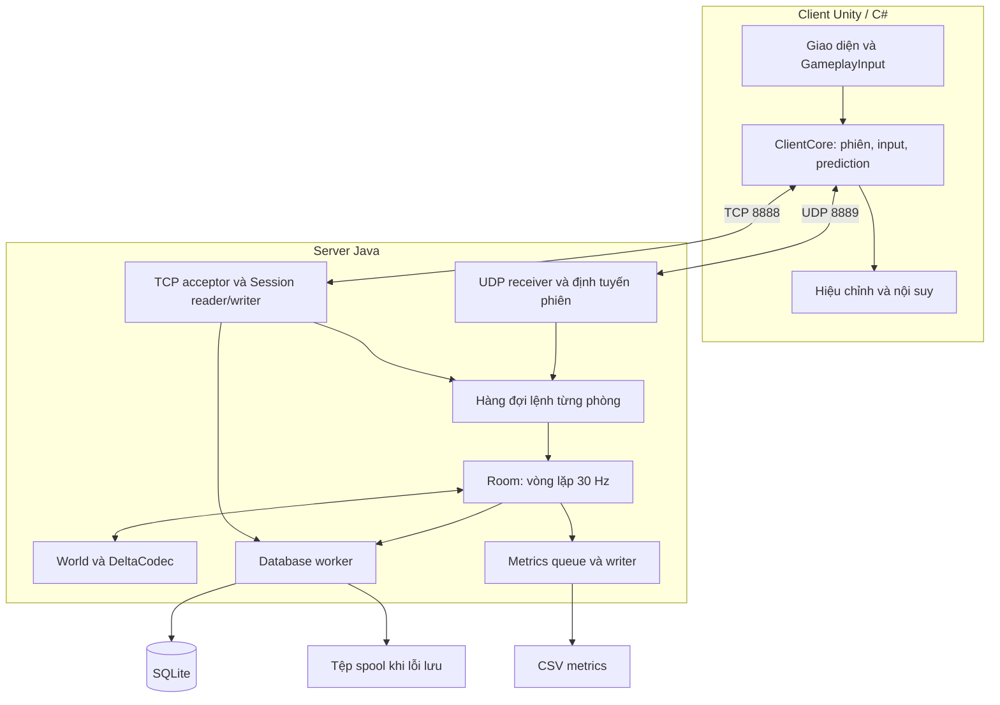
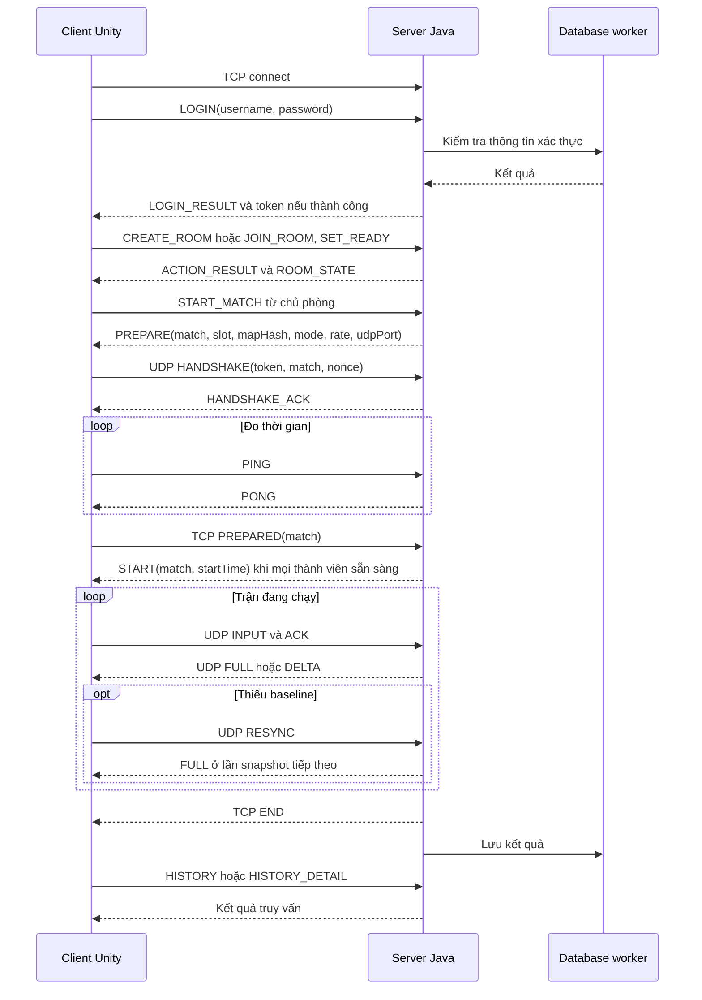

# TANK BATTLE: GAME XE TĂNG NHIỀU NGƯỜI CHƠI VỚI GIAO THỨC TCP/UDP VÀ ĐỒNG BỘ TRẠNG THÁI

**BÁO CÁO BÀI TẬP LỚN – LẬP TRÌNH MẠNG**  
**Năm học: 2026–2027**  
**Ngày biên soạn bản thảo: 15/10/2026**

> Trạng thái cập nhật ngày 15/10/2026: build server và 77 test Java đã đạt; benchmark socket hoàn tất 36/36 lượt, so sánh bốn mode trong ba điều kiện mạng với ba lần lặp. Xem [biên bản kiểm thử server](server_test_results.md) và [kết quả benchmark](benchmarks/network-20261015/results.md). Benchmark dùng client Java headless, chưa chạy client/test Unity. Web quản trị được giữ chỗ để bổ sung sau; không tính vào chức năng đã hoàn thành.

> Bổ sung: đã chạy lại riêng BASELINE với 9/9 lượt hợp lệ; xem mục 14.5 và [dữ liệu BASELINE chạy lại](benchmarks/baseline-rerun-20261015/results.md). Bộ này được giữ riêng, không thay thế hoặc gộp vào thống kê đối chứng 36 lượt trên.

Tài liệu giữ 24 mục chính theo mẫu `README.md` ở thư mục gốc bài tập. Các nội dung theo dạng technical paper trong `Instruction.md` được tích hợp vào các mục tương ứng; bảng đối chiếu nằm ở Phụ lục A. Không thay đổi README hướng dẫn chạy của Tank_Game.

## 1. Project Information – Thông tin đề tài

### 1.1. Project Name

**Tank Battle: Game xe tăng nhiều người chơi với giao thức TCP/UDP và đồng bộ trạng thái.**

Tên tiếng Anh: **Tank Battle: A Multiplayer Tank Game with TCP/UDP Communication and State Synchronization**.

### 1.2. Topic

**Chủ đề 2 – Phát triển game mạng**, theo `Topics.md`. Trọng tâm là kiến trúc client–server, thiết kế thông điệp, quản lý phiên, xử lý đồng thời và đồng bộ trạng thái.

### 1.3. Group

Thông tin hành chính chờ nhóm cung cấp; không suy đoán danh tính hoặc tỷ lệ đóng góp.

| STT | Mã sinh viên | Họ và tên | Email | Trách nhiệm chính | Đóng góp |
|---|---|---|---|---|---|
| Chờ bổ sung | Chờ bổ sung | Chờ bổ sung | Chờ bổ sung | Chờ xác nhận theo công việc thực tế | Chờ xác nhận |

Số thành viên tối đa theo hướng dẫn là 05. Tổng tỷ lệ đóng góp sau khi khai báo phải bằng 100%.

### 1.4. Instructor

**Giảng viên hướng dẫn:** Chờ bổ sung.

## 2. Project Summary – Tóm tắt đề tài

### 2.1. Problem

Game hành động nhiều người chơi cần duy trì một trạng thái chung trong khi mỗi máy nhận dữ liệu ở thời điểm khác nhau. Độ trễ, mất gói và đảo thứ tự có thể khiến thao tác bị thiếu hoặc hình ảnh bị giật. Nếu để client tự quyết định kết quả, các máy có thể không thống nhất về vị trí, va chạm và điểm số. Bên cạnh đó, server phải xử lý đồng thời nhiều người chơi, xác thực tài khoản, điều phối phòng và lưu kết quả mà không làm gián đoạn mô phỏng.

Bài toán của Tank Battle là thiết kế và triển khai hệ thống client–server cho game xe tăng, trong đó server giữ trạng thái có thẩm quyền, client gửi input và hiển thị trạng thái nhận được; các chức năng tài khoản và phòng chơi sử dụng kênh tin cậy, còn dữ liệu gameplay sử dụng cơ chế thích hợp với cập nhật liên tục.

### 2.2. Motivation

Đề tài kết hợp các nội dung lập trình mạng trong một chuỗi xử lý có thể quan sát: kết nối socket, xác thực, ghép phiên TCP với endpoint UDP, truyền lệnh, cập nhật thế giới, đồng bộ client và xử lý ngắt kết nối. Người chơi nhìn thấy trực tiếp tác động của độ trễ và mất gói, vì vậy game là môi trường phù hợp để thiết kế thực nghiệm so sánh các cơ chế mạng.

### 2.3. Objectives

1. Xây dựng giao tiếp giữa server Java và client Unity/C# bằng giao thức nhị phân thống nhất.
2. Phân tách TCP cho điều khiển phiên và UDP cho gameplay.
3. Mô phỏng tập trung ở 30 tick/giây, đồng bộ trạng thái tới từng client.
4. Triển khai gửi lặp input, delta snapshot, dự đoán cục bộ và hiệu chỉnh theo server.
5. Quản lý nhiều phiên/phòng bằng cơ chế xử lý đồng thời có giới hạn tài nguyên.
6. Xử lý dữ liệu sai, timeout, mất kết nối và lỗi lưu kết quả.
7. Đo lường và so sánh BASELINE, INPUT_REDUNDANCY, DELTA và COMBINED bằng số liệu thực tế, lưu cấu hình và dữ liệu để tái lập.

### 2.4. Scope

**Trong phạm vi hiện tại:** đăng ký/đăng nhập, phòng chờ, ready, bắt đầu trận, điều khiển xe tăng, đồng bộ trạng thái, kết thúc trận, lịch sử, các cơ chế độ tin cậy ở tầng ứng dụng và bộ kiểm thử trong repository. Môi trường kết nối mục tiêu là loopback, LAN hoặc VPN/Radmin theo hướng dẫn của dự án.

**Ngoài phạm vi hiện tại:** vận hành nhiều server phân tán, tự động ghép trận toàn cầu, tự động phát hiện gian lận, bảo đảm thông lượng trên Internet và web quản trị đã hoàn thiện. Không coi các giới hạn cấu hình là năng lực chịu tải đã được đo.

**Giữ chỗ web quản trị:** yêu cầu đã xác định trong [required_web.md](../required_web.md), gồm quản lý cặp IP–tài khoản, đăng nhập admin, CRUD quy tắc ban IP, ngắt kết nối và thông báo một chiều. Chưa mô tả các mục này như kết quả triển khai.

### 2.5. Abstract

Tank Battle là hệ thống game xe tăng nhiều người chơi sử dụng server Java và client Unity/C#. Hệ thống duy trì trạng thái có thẩm quyền tại server, dùng TCP cho xác thực/điều phối và UDP cho input/snapshot với giao thức nhị phân chung. Server mô phỏng 30 Hz; client Unity có prediction, reconciliation và nội suy trong mã nguồn. Sau khi build và 77 test Java đạt, nghiên cứu thăm dò thực hiện 36 lượt socket benchmark với bốn client Java headless, bốn mode, ba điều kiện mạng và ba seed. Trong phạm vi đo, COMBINED giảm 39,12–42,87% byte ứng dụng server đưa vào transport so với BASELINE. Ở cấu hình mất gói 5% không chèn delay, tỷ lệ input thiếu giảm từ 5,240% xuống 0,011%; đổi lại, các mode delta tăng chi phí mã hóa và xử lý server. Kết quả có dữ liệu gốc và độ lệch chuẩn theo lượt, nhưng thời lượng ngắn, n=3 và môi trường loopback chưa cho phép suy rộng tới Unity, LAN/Internet hoặc tải tối đa. Web quản trị kết nối được giữ chỗ để bổ sung sau khi triển khai.

### 2.6. Keywords

Client–server; TCP/UDP; giao thức nhị phân; đồng bộ trạng thái; input redundancy; delta snapshot.

### 2.7. Background / Related Work

TCP cung cấp luồng byte tin cậy và đúng thứ tự. Do không giữ ranh giới thông điệp ứng dụng, giao thức cần tự xác định độ dài từng frame. Đặc điểm này giải thích việc Tank Battle đọc header trước, sau đó đọc đủ payload. Tham khảo [RFC 9293](https://www.rfc-editor.org/rfc/rfc9293), mục 2.2 [1].

UDP cung cấp giao tiếp datagram với cơ chế giao vận tối giản, không bảo đảm phát lại hay chống trùng ở tầng giao thức. Vì vậy, ứng dụng cần tự quyết định dữ liệu nào được bỏ qua, lặp lại hoặc khôi phục. Tham khảo [RFC 768](https://www.rfc-editor.org/rfc/rfc768) [2]. Tank Battle bổ sung input theo tick, ACK snapshot và RESYNC để đáp ứng yêu cầu này.

SQLite WAL tách việc ghi thay đổi vào nhật ký trước khi checkpoint về tệp chính. Tài liệu SQLite mô tả khả năng reader và writer cùng hoạt động trong chế độ WAL, nhưng không có nghĩa nhiều writer được ghi đồng thời không giới hạn. Tham khảo [Write-Ahead Logging](https://www.sqlite.org/wal.html) [3]. Trong dự án, database vẫn được truy cập qua một worker riêng để kiểm soát thứ tự và tránh đặt công việc lưu trữ trong vòng lặp phòng.

Trong phạm vi báo cáo, đối chứng trực tiếp là chế độ BASELINE của cùng mã nguồn, không phải một sản phẩm bên ngoài. Cách này giữ phần lớn logic gameplay giống nhau khi so sánh các cơ chế mạng. Chưa có khảo sát đầy đủ các game thương mại hoặc chứng cứ để khẳng định kỹ thuật của dự án là thuật toán mới trong nghiên cứu.

### 2.8. Problem Definition

| Thành phần | Định nghĩa |
|---|---|
| Input | Yêu cầu tài khoản/phòng; input gameplay gồm tick, bitmask nút và góc ngắm |
| Output | Phản hồi nghiệp vụ, sự kiện phòng/trận, snapshot thế giới và lịch sử trận |
| Trạng thái chính thức | World do server cập nhật, gắn với một mã trận và các slot người chơi |
| Ràng buộc thời gian | Mô phỏng và snapshot cố định 30 Hz trong triển khai hiện có |
| Ràng buộc kích thước | Header 12 byte; payload tối đa 16.384 byte; toàn bộ frame UDP tối đa 1.200 byte |
| Ràng buộc tài nguyên | Tối đa cấu hình 8 người/phòng, 40 phòng, 320 phiên; hàng đợi có giới hạn |
| Giả định kết nối | Client chủ động kết nối IPv4; server có thể tiếp cận qua TCP và UDP được cấu hình |
| Điều kiện nhất quán | Client có cùng bản đồ/hash và luật di chuyển tương thích server |
| Mục tiêu đánh giá | Đúng giao thức, thống nhất trạng thái, phản hồi thao tác và sử dụng tài nguyên |

## 3. System Overview – Tổng quan hệ thống

### 3.1. System Description

Một server quản lý nhiều phiên TCP và nhiều phòng. Mỗi người chơi đăng nhập, tạo hoặc tham gia phòng rồi ready. Chủ phòng chỉ bắt đầu khi có ít nhất hai người và mọi thành viên đã ready. Server chọn bản đồ, tạo mã trận, yêu cầu client thiết lập UDP và chuẩn bị đồng hồ. Sau khi nhận đủ xác nhận, server thông báo thời điểm bắt đầu.

Trong trận, server nhận lệnh theo tick, cập nhật World và phát snapshot riêng cho từng người nhận. Cuối trận, kết quả được đưa sang worker database. Client truy vấn lịch sử thông qua server; máy client không giữ database tài khoản chung [S1–S5].

### 3.2. Target Users

Người chơi sử dụng client Unity để đăng nhập và thi đấu. Người vận hành chạy server, chọn cấu hình và đọc log/metrics. Admin web là đối tượng sẽ bổ sung sau, chưa có giao diện quản trị trong phạm vi triển khai đang mô tả.

### 3.3. Main Functions

| Chức năng | Thành phần chính | Trạng thái bằng chứng |
|---|---|---|
| Đăng ký, đăng nhập, đăng xuất | Server.Session, Database, ClientCore | Bộ Java đạt; client Unity chưa chạy |
| Tạo/vào/rời phòng, ready, cấu hình phòng | Server, Room, RoomAccess | Các test Java liên quan đạt; chưa demo Unity |
| Mô phỏng xe tăng và trận đấu | World, GameMap, Room | Các test gameplay Java đạt |
| FULL/DELTA, ACK và RESYNC | Room, DeltaCodec, ClientCore | Test Java đạt; đã đo FULL/DELTA; chưa benchmark phục hồi RESYNC |
| Dự đoán, hiệu chỉnh và nội suy | ClientCore, GameState, TankApp | Java sinh trace thành công; test C# chưa chạy |
| Lịch sử và chi tiết trận | Database, schema.sql | Các test Java liên quan đạt |
| Giả lập điều kiện mạng và metrics | UdpTransport, UdpImpairment, Metrics | Hoàn tất 36 lượt benchmark socket; Unity chưa chạy |
| Web quản trị kết nối | required_web.md | Chỉ có yêu cầu; giữ chỗ bổ sung |

## 4. System Architecture – Kiến trúc hệ thống

### 4.1. Architecture Diagram



Sơ đồ phản ánh luồng logic, không biểu diễn số lượng luồng hệ điều hành. Mũi tên từ client tới server qua TCP và UDP là hai kênh giao vận riêng, cùng được liên kết với một phiên đăng nhập.

**Giữ chỗ web:** bổ sung sơ đồ browser → API quản trị → server game sau khi có triển khai. Chưa xác định framework, cổng hoặc cách push dữ liệu thực tế.

### 4.2. Components

| Thành phần | Trách nhiệm |
|---|---|
| Server / Session | Lắng nghe TCP/UDP, xác thực phiên, dispatch opcode, gửi phản hồi |
| Room | Sở hữu thành viên, trạng thái phòng, hàng đợi lệnh và lịch mô phỏng |
| World | Tính chuyển động, va chạm, đạn, máu, điểm và trạng thái thế giới |
| InputBuffer | Nhận input theo tick, loại input trễ/trùng và xử lý thiếu input |
| Protocol Java/C# | Đóng/mở frame, kiểm tra header, mã hóa số và chuỗi |
| DeltaCodec Java/C# | So sánh hoặc áp dụng các trường thay đổi của trạng thái |
| ClientCore | Kết nối, nhận thông điệp, cache snapshot, input prediction và reconciliation |
| Rendering / TankApp | Nội suy thế giới và dùng trạng thái dự đoán cho xe người chơi |
| Database | Tài khoản, profile, lịch sử; transaction và spool kết quả |
| UdpTransport / UdpImpairment | Chèn điều kiện mạng giả lập khi bật cấu hình |
| Metrics | Thu thập số đếm, ghi CSV ngoài luồng mô phỏng |

### 4.3. Data Flow

**Luồng điều khiển:** giao diện gọi ClientCore.Request → frame TCP → Session.request → kiểm tra quyền/trạng thái → hàng đợi Room hoặc worker Database → phản hồi/sự kiện TCP.

**Luồng gameplay:** GameplayInput → input có tick → UDP có token/mã trận → Server.route → hàng đợi Room → InputBuffer → World.step → FULL/DELTA → client giải mã, cache và hiệu chỉnh.

**Luồng lưu trữ:** Room.finish tạo Result → Database.save đưa sang worker → ghi matches và match_players trong transaction. Nếu ghi lỗi, kết quả được giữ pending và thử spool để có thể phục hồi. Đây là cơ chế dự phòng, không bảo đảm lưu thành công nếu cả database lẫn tệp spool đều không ghi được [S5].

### 4.4. Proposed Approach – Thuật toán và quyết định thiết kế

#### 4.4.1. Mô phỏng có thẩm quyền tại server

World được cập nhật từ input đã kiểm tra, không nhận vị trí client tự khai báo làm trạng thái chính thức. Chọn cách này giúp các client nhận cùng cơ sở kết quả; đổi lại server chịu chi phí mô phỏng và trở thành điểm phụ thuộc tập trung.

Vòng lặp Room có chu kỳ danh định khoảng 33,33 ms. Khi trễ lịch, mã cho phép chạy bù tối đa ba bước trong một lượt rồi điều chỉnh mốc tiếp theo, tránh chạy bù không giới hạn. Giới hạn này cần được đưa vào phân tích khi xảy ra quá tải, vì thời gian tick mô phỏng và thời gian thực có thể lệch [S3].

#### 4.4.2. Input theo tick và gửi lặp

Mỗi input chứa tick mục tiêu, bitmask nút và góc ngắm. InputBuffer chỉ nhận input chưa được xử lý và không vượt quá 30 tick phía trước; input trùng được đếm và không thay thế tùy tiện. Khi thiếu input cho tick, server dùng nút bằng 0 và giữ góc hiện tại.

Trong chế độ gửi lặp, client đưa tối đa ba input gần nhất vào một datagram, input mới nhất được ghi trước. Input bị mất ở datagram trước có thể đến qua datagram sau nếu còn kịp tick. Đây là bù mất gói bằng dữ liệu dư, không phải cơ chế phát lại tin cậy toàn bộ UDP. Khi mất gói kéo dài hoặc input đến muộn, thao tác vẫn có thể bị bỏ.

#### 4.4.3. Delta dựa trên snapshot đã ACK

Server giữ cache snapshot cho từng thành viên và chỉ dùng baseline mà thành viên đã ACK, còn tồn tại trong cache. DeltaCodec so sánh các trường và dùng bitmask để ghi phần thay đổi; đối tượng thêm/xóa được biểu diễn tương ứng.

```text
Với mỗi tick và mỗi người nhận:
    full = trạng thái thế giới đã mã hóa
    base = snapshot mà client đã ACK, nếu còn trong cache
    nếu chế độ cho phép delta, không forceFull, tick không chia hết 30 và base tồn tại:
        delta = encode(base, full)
        nếu kích thước(delta) + 4 < kích thước(full): gửi DELTA kèm baseId
        ngược lại: gửi FULL
    ngược lại: gửi FULL
    lưu snapshot hiện tại; chỉ giữ tối đa 128 bản trong cache mỗi người
```

Phần cộng 4 là baseId trong payload DELTA. Client không có baseId sẽ yêu cầu RESYNC. Server cũng gửi FULL mỗi 30 tick để làm mới định kỳ. Tính nguyên tử khi áp dụng delta được hỗ trợ bằng cách giải mã vào bản trạng thái riêng, kiểm tra rồi mới trả kết quả; dữ liệu sai không được phép sửa dở cache gốc [S3, S6, S7].

#### 4.4.4. Prediction, reconciliation và interpolation

Client áp dụng input ngay trên bản Predicted để giảm thời gian chờ phản hồi hình ảnh. Khi snapshot đến, client lấy trạng thái chính thức của xe mình, loại input đã được server xử lý và phát lại input còn lại. Sai lệch nhỏ được làm mượt; các trường hợp lệch xa hoặc lịch sử quá lớn có thể reset dự đoán.

Hiển thị thế giới dùng mốc thời gian server ước lượng trừ 100 ms, nội suy giữa các snapshot bao quanh mốc đó. Khi không có mẫu phía sau, mã trả bản sao trạng thái phù hợp thay vì dự đoán thế giới vô hạn. Nội suy cũng xét ranh giới chết/hồi sinh và đổi hướng đạn để hạn chế tạo chuyển động không phù hợp [S7, S8].

### 4.5. Concurrency – Xử lý đồng thời

Server dùng virtual thread cho TCP acceptor, UDP receiver, reader/writer của Session và vòng lặp Room. Việc dùng virtual thread không tự loại bỏ race condition; mã vẫn sử dụng ConcurrentHashMap, biến volatile, atomic và các vùng synchronized tùy dữ liệu [S2, S3].

Thay đổi gameplay đi qua hàng đợi 256 lệnh của từng phòng, sau đó được xử lý ở đầu tick. Cơ chế này tập trung phần lớn thay đổi thành viên và World vào luồng phòng. Mỗi Session có hàng đợi gửi TCP tối đa 128 frame và writer riêng; đầy hàng đợi thì đóng phiên, giúp client không đọc dữ liệu không làm bộ nhớ tăng vô hạn.

Database dùng worker một luồng với hàng đợi 1.024 tác vụ; Metrics có hàng đợi 8.192 mẫu và writer riêng. Client đọc TCP/UDP bất đồng bộ, đưa packet vào ConcurrentQueue rồi Poll xử lý; một writer TCP riêng tránh nhiều tác vụ ghi đan xen vào cùng stream. Các giá trị này là giới hạn trong mã, không phải throughput đã đo.

Nguy cơ cần kiểm thử gồm: client đóng khi đăng nhập đang chờ database, phiên rời phòng trong lúc UDP đến, hàng đợi đầy và tác vụ callback trả kết quả sau khi trạng thái phiên đổi. FailureTest và ReliabilityTest đã đạt trong lượt chạy Java; kết quả xác nhận các tình huống được viết trong test, không chứng minh mọi lịch xen kẽ đồng thời đều an toàn.

## 5. Network Communication Design – Thiết kế giao tiếp mạng

### 5.1. Communication Model

Client chủ động mở TCP tới server và tạo UDP socket với cổng cục bộ được hệ điều hành cấp. Server TCP lắng nghe mặc định `0.0.0.0:8888`, UDP ở `0.0.0.0:8889`. `0.0.0.0` là địa chỉ bind, không phải địa chỉ nhập ở client.

Sau đăng nhập, token 16 byte gắn các datagram client gửi với Session tương ứng. UDP handshake ghi nhận endpoint ở giai đoạn chuẩn bị hoặc vào lại trận theo điều kiện mã nguồn; sau đó server yêu cầu endpoint khớp. Client cũng kiểm tra endpoint nguồn của datagram nhận [S2, S7].

### 5.2. Protocol

| Kênh | Nhóm thông điệp | Lý do lựa chọn |
|---|---|---|
| TCP | REGISTER, LOGIN, LOGOUT; phòng; PREPARE/PREPARED/START/END; lịch sử; HEARTBEAT; NOTICE | Các thao tác cần thứ tự và tính tin cậy của luồng |
| UDP | HANDSHAKE, PING/PONG, INPUT, ACK, RESYNC, FULL, DELTA | Cập nhật gameplay liên tục, ứng dụng chủ động xử lý thiếu hoặc cũ |

TCP bật `TCP_NODELAY`. Điều này là lựa chọn cấu hình để tránh việc gom các ghi nhỏ theo Nagle; chưa có thực nghiệm riêng đánh giá tác động trong dự án.

### 5.3. Message Format

#### Header chung

| Offset | Trường | Kích thước | Giá trị/ý nghĩa |
|---:|---|---:|---|
| 0 | Magic | 2 byte | `0x5442` |
| 2 | Version | 1 byte | `2` |
| 3 | Opcode | 1 byte | Loại thông điệp |
| 4 | Sequence | 4 byte | Ghép request/response hoặc theo dõi dãy gói UDP |
| 8 | Payload length | 2 byte | Độ dài payload, tối đa 16.384 byte |
| 10 | Flags | 2 byte | Hiện yêu cầu bằng 0 |
| 12 | Payload | Biến đổi | Theo opcode |

Số nguyên nhiều byte dùng big-endian; số thực f32 dùng biểu diễn 32 bit và bị từ chối nếu không hữu hạn. Chuỗi là `u16 byteLength + UTF-8 bytes`; giới hạn áp dụng theo byte của từng trường. `u32` thể hiện trường 32 bit trên dây; Java có thể giữ bit pattern trong `int` có dấu, vì vậy không được diễn giải mọi trường này như số dương Java thông thường.

TCP đọc đúng 12 byte header rồi đọc đúng số byte payload. UDP kiểm tra tổng độ dài khớp header, tối thiểu 12 và tối đa 1.200 byte. Header ứng dụng không có MAC hoặc chữ ký; token và sequence không thay thế cơ chế xác thực toàn vẹn bằng mật mã [S4].

#### Một số payload gameplay

| Message | Cấu trúc payload chính |
|---|---|
| INPUT | token[16], match:u64, ackSnapshot:u32, count:u8, lặp count lần {tick:u32, buttons:u8, angle:u16} |
| ACK | token[16], match:u64, snapshotId:u32 |
| RESYNC | token[16], match:u64, snapshotId:u32 |
| HANDSHAKE | token[16], match:u64, nonce:u64 |
| PING | token[16], match:u64, clientTime:u64 |
| PONG | match:u64, clientTime:u64, serverReceiveTime:u64, serverSendTime:u64 |
| FULL | match:u64, snapshotId:u32, tick:u32, serverTime:u64, resolvedTick:u32, remainingTicks:u16, fullWorld |
| DELTA | Các trường chung như FULL, tiếp theo baseId:u32 và deltaWorld |

Prefix token/match ở bảng là của các gói client → server tương ứng; không suy rộng rằng mọi thông điệp hai chiều đều mang token. ACK snapshot cũng được gửi kèm trong INPUT. RESYNC hiện đặt cờ yêu cầu FULL, không yêu cầu server phát lại chính xác bản snapshotId được nêu.

Ví dụ frame REGISTER trong fixture của ProtocolTest:

```text
544202010102030400100000000474616e6b000870617373776f7264

magic=5442, version=02, opcode=01, sequence=01020304,
payloadLength=0010, flags=0000,
username="tank", password="password".
```

Đây là vector kiểm thử có sẵn, không phải gói tin đã bắt từ phiên chạy thực tế. Mật khẩu trong ví dụ đi dưới dạng UTF-8 trên TCP; mã hiện có chưa dùng TLS.

### 5.4. Communication Sequence



Sequence mô tả một client đại diện; server còn chờ các thành viên khác. Mốc bắt đầu được đặt khoảng 3 giây sau thời điểm mọi thành viên chuẩn bị xong. Client thu ít nhất 8 mẫu ping trong giai đoạn chuẩn bị trước khi gửi PREPARED [S3, S7].

Ước lượng thời gian dùng bốn mốc t1: client gửi, t2: server nhận, t3: server gửi và t4: client nhận:

```text
RTT = (t4 - t1) - (t3 - t2)
offset = ((t2 - t1) + (t3 - t4)) / 2
serverTimeEstimated = clientTime + offset
```

Các timestamp dùng đồng hồ đơn điệu tính theo microsecond cho đồng bộ gameplay. Timestamp lịch sử sử dụng thời gian lịch. Offset là ước lượng, chịu ảnh hưởng của độ bất đối xứng đường truyền; không phải đồng bộ đồng hồ chính xác tuyệt đối.

### 5.5. Error Handling

| Tình huống | Xử lý thể hiện trong mã | Giới hạn cần lưu ý |
|---|---|---|
| Header sai, độ dài sai, UTF-8 lỗi, float không hữu hạn | Parser từ chối; UDP không hợp lệ bị loại/đếm; lỗi đọc TCP có thể đóng phiên | ProtocolTest đạt; chưa có kiểm thử fuzzing toàn diện |
| Yêu cầu không hợp lệ hoặc sai trạng thái | Trả mã INVALID_REQUEST, INVALID_STATE hoặc mã nghiệp vụ tương ứng | Không đồng nghĩa xử lý idempotent mọi yêu cầu |
| Chưa đăng nhập, sai mật khẩu, đăng nhập trùng | Từ chối theo mã lỗi xác thực | Có rate limit theo IP cho xác thực |
| TCP không có dữ liệu hợp lệ đủ lâu | Client heartbeat khoảng 5 giây; timeout danh định 15 giây | Thời điểm đóng thực tế phụ thuộc lịch xử lý |
| Chuẩn bị hoặc UDP handshake quá hạn | Hủy chuẩn bị/đóng kết nối theo nhánh xử lý | Không bắt đầu trận nếu điều kiện chưa đủ |
| UDP im lặng trong trận | Server loại thành viên khi vượt 10 giây | Client cũng có cơ chế yêu cầu đồng bộ lại |
| Input thiếu, trễ, trùng, vượt cửa sổ | Dùng input trung tính hoặc loại và tăng bộ đếm | Không bảo đảm mọi thao tác đều được áp dụng |
| Client thiếu delta baseline | Giới hạn tần suất RESYNC, server gửi FULL | Cần đo thời gian phục hồi |
| Client nhận chậm làm đầy outbound | Đóng phiên, phòng xử lý mất kết nối | Chưa đo ảnh hưởng dưới tải lớn |
| Database ghi kết quả lỗi | Rollback, pending/spool và thử lại | Cả DB và spool lỗi vẫn có nguy cơ mất kết quả |

UDP rate limit còn kiểm soát endpoint và phiên; lệnh nghiệp vụ có rate limit riêng. RateLimit dùng cơ chế token bucket. Các lớp bảo vệ này không phải tường lửa hoặc hệ thống chống DDoS đầy đủ.

### 5.6. Connection Closure và trạng thái phòng

Session.close đánh dấu đóng, yêu cầu rời phòng, xóa tài khoản khỏi danh sách đăng nhập, xóa token/endpoint, bỏ khỏi tập kết nối và đóng socket. Room xử lý việc loại xe, lưu trạng thái điểm liên quan, chuyển chủ phòng và kết thúc trận nếu không còn đủ người chơi. Việc vào lại trận được kiểm soát qua điều kiện trong Room; không hiểu thành client tự động reconnect vô hạn.

Vòng đời chính của phòng là `WAITING → PREPARING → RUNNING → RESULTS → WAITING`. PREPARING có thể quay về WAITING nếu quá hạn hoặc có thành viên rời; phòng trống được gỡ khỏi server.

## 6. Technology Stack – Công nghệ và triển khai

| Nhóm | Công nghệ/phiên bản khai báo | Vai trò |
|---|---|---|
| Server | Java 21 | Socket, virtual thread, mô phỏng, nghiệp vụ |
| Client | Unity 6000.3.24f1, C# | UI, input, mạng và hiển thị |
| Database | SQLite qua sqlite-jdbc 3.46.1.0 | Tài khoản, profile, lịch sử |
| JSON | Gson 2.11.0 | Bản đồ/cấu trúc dữ liệu JSON và spool |
| Logging dependency | slf4j-simple 1.7.36 | Dependency logging trong pom.xml |
| Java test | JUnit Jupiter 5.11.0 | Unit/integration/regression test |
| Unity test | com.unity.test-framework 1.6.0 | EditMode test |
| Build server | Maven; yêu cầu hướng dẫn 3.9.x | Compile, test và tạo JAR |
| Scripts | PowerShell, Python 3 | Build, chạy, kiểm tra hợp đồng dùng chung |
| Hệ điều hành hướng dẫn | Windows | Môi trường chạy các script được cung cấp |
| Web quản trị | Chưa triển khai | Giữ chỗ cập nhật stack thực tế |

Các dependency và Unity ở bảng lấy từ tệp khai báo. Môi trường thực chạy server đã xác minh: Eclipse Adoptium Java 21.0.8, Maven 3.9.14, Python 3.10.8, Windows 11 amd64. Chưa chạy Unity để kiểm tra môi trường client. Chi tiết và cách xử lý đường dẫn Unicode ở [biên bản kiểm thử](server_test_results.md).

### 6.1. Module và cấu trúc dữ liệu quan trọng

Server giữ `ConcurrentHashMap` cho phòng, tài khoản và token; tập phiên hỗ trợ truy cập đồng thời. Room giữ thành viên theo slot, hàng đợi lệnh và cache snapshot riêng từng người. InputBuffer ánh xạ tick sang input. ClientCore giữ lịch sử input, lịch sử dự đoán, snapshot gần nhất và cache tối đa 128 trạng thái để áp dụng delta.

`source/shared/game-rules.json` chứa các hằng số gameplay dùng chung. Script sync-contracts.py sinh/kiểm tra các bản Java và C#; build-server.ps1 gọi chế độ `--check`. Cơ chế này giảm nguy cơ server và client dự đoán theo các hằng số khác nhau, nhưng không tự chứng minh toàn bộ logic hai phía tương đương.

### 6.2. Database và tính bền vững

| Bảng | Nội dung chính | Quan hệ |
|---|---|---|
| accounts | username, salt, hash, iterations, thời điểm tạo | id là khóa chính; username duy nhất |
| player_profiles | display_name | account_id tham chiếu accounts |
| matches | map, mode, thời gian, lý do kết thúc, seed, duration_ticks | id là khóa chính |
| match_players | nickname, slot, kills, deaths, rank, disconnected | Khóa ghép match_id/account_id; tham chiếu matches và accounts |

Schema bật foreign_keys, WAL và busy_timeout 5.000 ms. Mật khẩu được băm bằng PBKDF2WithHmacSHA256 với salt ngẫu nhiên 16 byte, 600.000 vòng và đầu ra 256 bit theo mã đăng ký. Không lưu mật khẩu gốc trong bảng accounts. Bảo vệ lưu trữ này khác với bảo vệ đường truyền: LOGIN/REGISTER hiện truyền qua TCP chưa mã hóa [S5].

### 6.3. Giữ chỗ Implementation web quản trị

Sau khi hoàn thiện web, bổ sung module frontend/backend, xác thực admin, mô hình quy tắc ban IP, lịch sử IP–tài khoản, API, cơ chế cập nhật trạng thái và kiểm soát đồng thời khi ngắt phiên. Chưa đặt tên bảng/API như thể đã tồn tại. Phạm vi Admin không bao gồm sửa/xóa tài khoản người chơi.

## 7. Novelty and Contributions – Cải tiến và đóng góp

### 7.1. Baseline

Baseline kỹ thuật là `network.mode=BASELINE` trong cùng codebase: mỗi gói INPUT mang một input và server gửi FULL snapshot. Baseline này vẫn dùng TCP/UDP, server-authoritative, prediction và các kiểm tra lỗi chung; không được coi baseline là phiên bản không có mọi cơ chế đồng bộ.

`BaselineTest` đã đạt trong bộ 77 test Java nhưng chỉ kiểm tra luồng chức năng. Benchmark đối chứng được thực hiện riêng bằng NetworkBenchmark, chạy JAR server qua socket thật và ghi metrics cho 36 lượt; không dùng thời gian của JUnit làm số đo hiệu năng game.

### 7.2. Proposed Improvement

Hai yếu tố so sánh là input redundancy và delta snapshot. Ma trận bốn chế độ cho phép quan sát từng yếu tố và khi kết hợp. Trong benchmark một phòng bốn client, redundancy làm giảm input thiếu ở cả hai profile mất gói; delta làm giảm byte server đưa vào transport và tăng thời gian encode. Đây là kết quả trong workload đã đo, không khẳng định COMBINED tốt nhất ở mọi tiêu chí hoặc mạng thực tế. Phần Results/Discussion trình bày số liệu và giới hạn suy luận.

### 7.3. Contributions

| Nội dung kỹ thuật có trong mã | Mô tả | Bằng chứng hiện có | Bằng chứng còn thiếu |
|---|---|---|---|
| Gửi lặp input theo tick | Tối đa ba input/gói và lọc trùng tại server | Test Java và tỷ lệ input thiếu qua 36 lượt benchmark | Mạng nhiều máy, mức loss khác và burst loss |
| Delta dựa trên ACK | Baseline riêng từng client, bitmask, fallback FULL, RESYNC | DeltaTest/FailureTest đạt; đã đo byte và encode time | Recovery time khi thật sự xảy ra thiếu baseline/RESYNC |
| Hợp đồng Java/C# | Framing chung, shared constants và golden fixture | ProtocolTest, GoldenInteropTest và PredictionTest Java đạt | Kết quả chạy C# để xác nhận hai chiều |
| Tách mô phỏng khỏi I/O lưu trữ | Room queue, database worker, metrics writer | Test đạt; đã đo tick p95 và queue depth ở một phòng bốn client | Khả năng chịu tải nhiều phòng và đối chứng riêng cơ chế I/O |
| Web quản trị kết nối | Quản lý IP–tài khoản và thực thi lệnh admin | Mới có required_web.md | Toàn bộ implementation và đánh giá |

Các cơ chế trên là nội dung triển khai có thể trình bày như đóng góp kỹ thuật của giải pháp. **Chưa đủ thông tin để quy toàn bộ cho nhóm sinh viên tự phát triển.** Trước khi nộp, nhóm phải xác nhận nguồn gốc codebase, phần kế thừa và phần tự viết, kèm commit/tài liệu hoặc bằng chứng phù hợp. Không khẳng định tính mới nghiên cứu chỉ từ việc các kỹ thuật đã được tích hợp.

### 7.4. Baseline vs Proposed

| Yếu tố | BASELINE | INPUT_REDUNDANCY | DELTA | COMBINED |
|---|---|---|---|---|
| Input/gói | 1 | Tối đa 3 | 1 | Tối đa 3 |
| Snapshot | FULL | FULL | FULL hoặc DELTA | FULL hoặc DELTA |
| Dùng ACK làm delta base | Không dùng để mã hóa delta | Không dùng để mã hóa delta | Có | Có |
| Prediction/nội suy client | Có | Có | Có | Có |
| Tần số mô phỏng/snapshot | 30 Hz | 30 Hz | 30 Hz | 30 Hz |
| Kết quả hiệu năng | 9 lượt hợp lệ | 9 lượt hợp lệ | 9 lượt hợp lệ | 9 lượt hợp lệ |

## 8. Project Structure – Cấu trúc dự án

```text
BTL_LTM/
├── README.md                  Mẫu trình bày của học phần
├── Instruction.md             Yêu cầu thực hiện và đánh giá
├── Topics.md                  Chủ đề bài tập lớn
└── Tank_Game/
    ├── README.md              Hướng dẫn dự án hiện có
    ├── required_web.md        Yêu cầu web quản trị, chưa phải implementation
    ├── config/                Cấu hình server và mẫu công cụ
    ├── scripts/               Build, chạy, test và sync contracts
    ├── source/
    │   ├── server/            Java, schema.sql và JUnit test
    │   ├── client/            Unity, C# và EditMode test
    │   └── shared/            game-rules.json
    └── report/
        └── bao_cao.md         Bản thảo báo cáo này
```

Khi build/chạy, công cụ có thể tạo build/, runtime/ và source/server/target/. Không mặc định các thư mục sinh ra đó đã tồn tại hoặc là bằng chứng chạy thành công.

## 9. Requirements – Yêu cầu môi trường

### Hardware

Môi trường benchmark đã ghi nhận bằng truy vấn hệ thống: AMD Ryzen 5 7235HS, 4 nhân/8 bộ xử lý logic, RAM hệ điều hành báo 25.439.199.232 byte (khoảng 23,69 GiB), Windows 11 amd64. Không dùng GPU/rendering trong công cụ phát tải Java. Chưa có phép đo để đề xuất cấu hình tối thiểu bảo đảm 320 phiên hoặc 40 phòng.

### Software

- Build server: JDK 21, Maven 3.9.x, Python 3 theo hướng dẫn repository.
- Mở/build client: Unity Hub, Unity Editor 6000.3.24f1, Windows Build Support và license đã kích hoạt.
- Chạy server JAR đã build: JDK 21.
- Chạy client Windows đã build: toàn bộ thư mục bản phát hành; không yêu cầu cài Unity Editor.
- Chơi nhiều máy: cùng LAN hoặc VPN phù hợp, server cho phép TCP/UDP theo cổng cấu hình.

## 10. Installation – Cài đặt

Các lệnh ở mục 10–11 là hướng dẫn tái lập lấy từ repository. Build server đã được thực hiện và đạt theo [biên bản](server_test_results.md); hướng dẫn chạy server lâu dài, build/chạy/test client chưa được thực hiện trong lượt này.

### 10.1. Clone / Download

Nhận đầy đủ thư mục Tank_Game từ nguồn nhóm cung cấp. Đường dẫn repository hoặc Google Drive chính thức: chờ bổ sung. Mở PowerShell tại thư mục Tank_Game trước khi dùng các lệnh tương đối dưới đây.

### 10.2. Install Dependencies

Cài JDK, Maven và Python theo phiên bản trên; cài Unity Editor đúng phiên bản nếu cần build/test client. Maven lấy dependency từ pom.xml; Unity lấy package từ manifest.json. Không có căn cứ để xác nhận dependency đã được tải đầy đủ trên máy hiện tại.

### 10.3. Database Setup

Không yêu cầu phát hành sẵn database người dùng. Khi khởi động, server mở/tạo `runtime/tank.db`, nạp `schema.sql` đóng gói trong JAR và thực hiện phần migration trong Database. Database nằm trên máy server; mỗi server dùng database độc lập. Không đưa tài khoản thử hoặc dữ liệu người dùng thật vào gói nguồn công khai.

### 10.4. Configuration

| Tham số | Mặc định | Ý nghĩa |
|---|---|---|
| bind | 0.0.0.0 | Địa chỉ server lắng nghe |
| tcp.port / udp.port | 8888 / 8889 | Cổng TCP và UDP |
| tick.rate / snapshot.rate | 30 / 30 | Mã hiện có chỉ chấp nhận 30 Hz |
| network.mode | COMBINED | Chế độ mạng |
| max.players / max.rooms / max.sessions | 8 / 40 / 320 | Giới hạn cấu hình |
| match.ticks | 5400 | Trận mặc định 180 giây mô phỏng ở 30 Hz |
| database.path | runtime/tank.db | Database tập trung |
| spool.path | runtime/spool | Kết quả chờ ghi khi DB lỗi |
| metrics.path | runtime/server.csv | Đầu ra metrics server |
| impairment.enabled | false | Bật mô phỏng điều kiện mạng |

`start-server.ps1` chọn server.local.properties nếu có, nếu không chọn server.properties. File local là bản cấu hình đầy đủ, không được tự ghép với file mặc định. Cấu hình trận rút ngắn ở cấp server yêu cầu benchmark=true; thiết lập thời lượng phòng theo giao diện được kiểm tra riêng trong logic phòng [S1, S3].

## 11. Running the Project – Hướng dẫn chạy

### 11.1. Start Server

```powershell
./scripts/build-server.ps1
./scripts/start-server.ps1
```

Lệnh build kiểm tra shared constants, gọi Maven `clean package`, chạy test trong lifecycle và tạo `build/server/tank-server-1.0.0.jar`. Người dùng đã xác nhận bước build/test server; lượt chạy ngày 15/10/2026 kết thúc BUILD SUCCESS với 77 test đạt. PowerShell ExecutionPolicy được bypass riêng ở tiến trình chạy, không sửa cấu hình hệ thống. Đường dẫn tạm không dấu trỏ tới project được dùng để tránh lỗi JDK nhận sai đường dẫn tiếng Việt.

### 11.2. Start Client

Trong Unity Hub, mở project `source/client`, scene `Assets/Scenes/Main.unity` và Play; hoặc build bằng:

```powershell
./scripts/build-client.ps1
```

Sau build, chạy `build/client/TankBattle.exe`. Bản phát hành phải gồm toàn bộ thư mục client, không chỉ file exe. Cài đặt kết nối dùng `127.0.0.1` nếu cùng máy hoặc IPv4 thật của server nếu khác máy.

### 11.3. Start Multiple Clients

Mở ít nhất hai client hoặc phân phối bản build tới các máy cùng mạng. Mỗi client đăng nhập một tài khoản riêng, cùng vào phòng, ready; chủ phòng bắt đầu. Không giả định số lần mở client thực tế hoặc khả năng chạy nhiều cửa sổ đã được kiểm chứng trên máy hiện tại.

### 11.4. Run Test

Test Java nằm trong quá trình build-server.ps1. Test Unity chạy sau khi Java đã tạo các fixture interop cần thiết và Unity Editor cùng project đã đóng:

```powershell
./scripts/test-client.ps1
```

Đầu ra Java đã xác minh: XML ở `source/server/target/surefire-reports/` và ba fixture ở `source/server/target/interop/`. XML của 17 lớp ghi tổng 77 test, không failures/errors/skipped. Đầu ra Unity như `runtime/unity-tests.xml` chưa được tạo/xác minh trong lượt này. Không suy rộng kết quả Java thành test Unity đã đạt.

## 12. Main Features – Chức năng và kiểm thử

| ID | Chức năng | Bằng chứng mã/test | Kết quả chạy trong đợt báo cáo |
|---|---|---|---|
| F01 | Tài khoản, lobby, trận và lịch sử | BaselineTest, DatabaseTest | Java đạt: 1 + 3 test |
| F02 | Framing, thứ tự byte, dữ liệu sai | ProtocolTest, ProtocolTests.cs | Java đạt: 3 test; C# chưa chạy |
| F03 | Delta round-trip và Java/C# | DeltaTest, GoldenInteropTest, ProtocolTests.cs | Java đạt: 2 + 1 test; C# chưa chạy |
| F04 | Di chuyển và prediction tương thích | PredictionTest, test movement ở client | Java đạt: 1 test; C# chưa chạy |
| F05 | Client không đọc và hàng đợi đầy | ReliabilityTest | Java đạt: 7 test |
| F06 | Cổng bận, đăng nhập đang chờ rồi đóng phiên | FailureTest | Java đạt: 7 test |
| F07 | UDP timeout, gián đoạn tạm thời và phục hồi | ReliabilityTest, PlayerRecoveryTest | Java đạt: 7 + 4 test; trùng ReliabilityTest ở F05 |
| F08 | Room settings, gameplay, thời lượng và rejoin | Các test Room*, MatchDuration*, AfkRejoinAndHitTest; test client tương ứng | Các lớp Java đạt; C# chưa chạy |
| F09 | Web: đăng nhập admin, xem phiên, ban, ngắt, NOTICE | required_web.md | Chưa triển khai; giữ chỗ |

Kết quả lấy từ XML Surefire của lượt chạy thành công. Một lớp có thể phục vụ nhiều dòng chức năng, vì vậy không cộng số test trong bảng này để tính tổng. Tổng chính xác là 77 test thuộc 17 lớp; bảng theo lớp đầy đủ ở [biên bản kiểm thử](server_test_results.md). Kết quả đạt chỉ áp dụng những assertion và môi trường đã chạy, không thay thế nghiệm thu game bằng client Unity thật.

## 13. Experimental Setup – Thiết kế thực nghiệm

### 13.1. Environment

Bộ test Java đã chạy thành công; người dùng đã cho phép benchmark hiệu năng. Môi trường đo gồm Java 21.0.8 (Eclipse Adoptium), Python 3.10.8, Windows 11 amd64, Ryzen 5 7235HS 4 nhân/8 luồng và RAM khoảng 23,69 GiB. Server chạy JVM riêng với `-Xms128m -Xmx512m`; bộ phát tải Java chạy ở tiến trình khác trên cùng máy. JAR giữ nguyên SHA-256 như lượt build ở server_test_results.md.

Benchmark dùng [NetworkBenchmark.java](../scripts/benchmark/NetworkBenchmark.java) và [analyze.py](../scripts/benchmark/analyze.py), mới bổ sung riêng cho phép đo, không sửa gameplay hoặc JAR server. Cấu hình và phương pháp đầy đủ ở [README benchmark](../scripts/benchmark/README.md). Việc chạy client/test Unity chưa được thực hiện.

Các loại thông tin cần lưu kèm mỗi lượt:

| Trường | Nội dung cần ghi |
|---|---|
| Mã nguồn | Commit nếu có, hoặc bản chụp/hash nguồn; ngày giờ build |
| Máy server/client | CPU, RAM, GPU, hệ điều hành, máy vật lý hay VM |
| Công cụ | Java, Maven, Python, Unity và build configuration thực tế |
| Mạng | Loopback/LAN/VPN, loại kết nối và băng thông nếu xác định được |
| Cấu hình | Mode, map, players, rooms, duration, seed và impairment |
| Trình sinh tải | Client thật hoặc công cụ tự động; cách tạo và phát lịch input |
| Bằng chứng | Log, CSV, XML test, cấu hình từng lượt và ảnh chụp thực tế |

Phép đo dùng IPv4 loopback với 4 client headless và một phòng; không sử dụng Unity. Kết quả phản ánh server/giao thức dưới lịch input tổng hợp và điều kiện lỗi chèn tại wrapper server, không đại diện chất lượng LAN/Internet hoặc thời gian input-to-photon. CPU/memory server được lấy ở JVM server nhưng client phát tải vẫn dùng chung tài nguyên máy chủ.

### 13.2. Dataset

Dự án có hai bản đồ map.json/map-large.json; lượt đo 4 người dùng map.json theo logic chọn map của server. Input được xác định theo tick và slot: đổi hướng mỗi 30 tick, giữ nút bắn, thay đổi góc ngắm theo công thức cố định. Mỗi client thực hiện đăng ký/đăng nhập, vào phòng, ready, handshake và đồng bộ thời gian, rồi truyền INPUT/ACK và giải mã snapshot qua socket thật. Bộ phát tải không thực hiện prediction hoặc rendering của Unity. Bộ fixture protocol/movement/delta do test Java sinh là dữ liệu kiểm tra tương thích, không phải dataset hiệu năng hoặc packet capture thực tế.

So sánh các mode phải giữ cùng bản đồ, số người, lịch input, thời lượng và tập seed; log mỗi lượt cần ghi đủ cấu hình. Trong mã UdpTransport, random stream TX/RX được tách và có seed. Dù cùng seed, các mode có số lượng gói khác nhau nên không mặc định cùng một input sẽ chịu đúng cùng sự kiện mất gói. Cần lặp nhiều seed và báo biến thiên.

### 13.3. Test Scenarios

**Kịch bản 1 – Đúng chức năng và tương thích.** Bộ 77 test Java đã đạt. Trước benchmark có pilot riêng cho 4 mode, mỗi lượt 6 giây và warm-up 2 giây, để xác minh khởi tạo phiên, giải mã và kết thúc trận; pilot không gộp vào thống kê chính thức. Test Unity và demo bằng client đồ họa vẫn chưa chạy.

**Kịch bản 2 – So sánh bốn mode trên mạng không chèn lỗi.** Một phòng bốn người, cùng bản đồ và công thức input; đối chiếu byte UDP ứng dụng, input thiếu, encode time và tick time. Profile `clean` tắt impairment.

**Kịch bản 3 – Mất gói và độ trễ.** Profile `loss5` chèn mất 5% mỗi chiều, không thêm delay; profile `delay50_jitter20_loss5` chèn mất 5%, delay 50 ms và jitter phân bố đều trong ±20 ms mỗi chiều. Impairment chỉ bật ở server, không chèn thêm ở client. Đây là tham số tác động, không phải RTT thực đo. Duplicate, reorder cấu hình và burst loss đều bằng 0; delay ngẫu nhiên vẫn có thể làm gói đến khác thứ tự.

**Kịch bản 4 – Burst loss, duplicate, reorder và RESYNC (chưa thực hiện).** Đây là hướng mở rộng để đo phục hồi khi mất gói theo đợt, thiếu baseline hoặc gián đoạn UDP. Không suy ra recovery time từ một lượt không có sự kiện RESYNC; chưa đưa ra số đo phục hồi cho kịch bản này.

**Kịch bản 5 – Nhiều phòng và client chậm (chưa benchmark).** Việc tăng số phòng/client cần phép đo tải riêng. Các tình huống client không đọc, dữ liệu sai và DB lỗi đã có bằng chứng test Java, nhưng không tương đương đo throughput hay khả năng phục vụ 320 client.

**Quy trình thực tế của lượt đo đầu:** 4 mode × 3 profile × 3 repeat, tổng 36 lượt, mỗi trận 30 giây mô phỏng, warm-up 5 giây. Seed lần lượt là 20261016, 20261017 và 20261018. Các lượt chạy tuần tự; thứ tự mode được xáo trộn tái lập trong từng cặp profile/repeat. Mỗi lượt dùng JVM server, database, cổng và tệp đầu ra riêng. Đây là benchmark thăm dò, rút gọn so với kế hoạch 180 giây/5 lần lặp trong bản thảo ban đầu; chưa dùng để khẳng định ý nghĩa thống kê hoặc khả năng chịu tải cực đại.

Tick 150 dùng làm mốc bộ đếm; đo tick 151–899, tương ứng 749 tick/lượt. Không dùng tick cuối 900 vì client có thể nhận END rồi đóng phiên trước khi Metrics.row lấy xong số đếm thành viên. Rate lấy chênh lệch counter chia thời gian thực từ mốc tick 150 tới 899. Kiểm tra đủ dòng metrics và đẳng thức `Δinput_ontime + Δinput_missing = 4 × 749` trước khi chấp nhận lượt. Mọi client phải END bình thường, không bị disconnected và không có lỗi giải mã. p95 được tính theo từng lượt rồi báo mean và sample SD giữa ba lượt; không gộp tick thành các lần lặp độc lập.

**Giữ chỗ web:** sau triển khai, thêm kiểm thử quyền admin, CRUD ban, nhiều tài khoản chung IP, ngắt khi đang chơi và thông báo theo nhóm; đo thời gian lệnh quản trị có hiệu lực cùng ảnh hưởng lên tick game. Không thực hiện các test này trên chức năng chưa tồn tại.

### 13.4. Evaluation Metrics

| Metric | Định nghĩa/cách tính | Nguồn hoặc yêu cầu bổ sung |
|---|---|---|
| UDP byte rate | Chênh lệch bộ đếm tx_bytes/rx_bytes chia thời gian thực đo | Metrics; byte của frame ứng dụng, không gồm IP/UDP/Ethernet header |
| UDP packet rate | Chênh lệch tx_packets/rx_packets chia thời gian | Metrics; cần nêu điểm đếm |
| Input missing ratio | Δmissing / (Δmissing + ΔonTime) | Tổng InputBuffer trong phạm vi đo; nêu rõ người chơi tham gia |
| Input late/duplicate/conflict | Chênh lệch bộ đếm tương ứng | Metrics/InputBuffer |
| Tick duration | Thời gian xử lý một tick | tick_us; báo trung vị, p95, p99 theo lượt |
| Schedule lag / overrun | Lệch lịch và điều kiện vượt budget theo mã Metrics | schedule_lag_us, overrun; không coi chỉ tick_us là toàn bộ trễ |
| Delta ratio | Δdelta / (Δdelta + Δfull) | Metrics; loại khoảng khởi động nếu đã quy định |
| Encode time | Thời gian mã hóa full/delta theo điểm đặt timer | encode_us; gồm công việc mã hóa được mã ghi nhận |
| RTT | Bốn timestamp theo mục 5.4 | ClientCore có trường đo; cần thu log nếu chưa xuất |
| Snapshot age | Thời gian server ước lượng ở client trừ thời gian snapshot | LastStateAgeUs; phụ thuộc sai số offset |
| Prediction error | Khoảng cách trước/sau reconciliation theo mã client | PredictionError; cần ghi chuỗi mẫu để thống kê |
| Recovery time | Thời gian từ yêu cầu resync được client ghi nhận tới snapshot giải mã được | RecoveryUs; không phải mọi dạng phục hồi mạng |
| CPU/heap/GC | Số liệu runtime server | Metrics; process_cpu_ns cần lấy chênh lệch theo thời gian để quy đổi |

Các bộ đếm Metrics là tích lũy; tính rate phải lấy chênh lệch, không lấy nguyên tổng cuối chia tùy tiện. Một số bộ đếm TX/RX là toàn server nhưng được lặp trên các dòng của từng phòng: không cộng các dòng đó như dữ liệu riêng từng phòng. Muốn phân tích lưu lượng theo phòng cần bổ sung điểm đo phù hợp và xin xác nhận trước khi sửa/chạy mã.

txBytes được tăng ở đường gửi ứng dụng trước khi xét đầy đủ việc datagram thực sự tới đích; impairment có thể làm gói bị loại sau đó. rxBytes phản ánh đường nhận hợp lệ được mã ghi nhận, không phải mọi byte trên card mạng. Vì vậy, không gọi các giá trị này là băng thông trên dây hoặc tỷ lệ mất gói thực tế nếu chưa có phép đo bổ sung. SequenceGaps cũng là chỉ báo khoảng trống dãy gói theo timeout, không tự tương đương loss ở tầng IP.

## 14. Experimental Results – Kết quả

### 14.1. Functional Results

**Kết quả phân tích tĩnh:** xác định được giao thức nhị phân phiên bản 2, phân chia TCP/UDP, vòng lặp 30 Hz, bốn chế độ mạng, các hàng đợi hữu hạn và schema lưu trữ. Những nội dung này có thể đối chiếu tại các tệp nguồn trong danh mục S1–S10; số liệu benchmark tham chiếu S11.

**Kết quả chạy server ngày 15/10/2026:** kiểm tra shared gameplay contracts đạt; biên dịch 16 tệp Java chính và 17 tệp test; Surefire chạy 77 test thuộc 17 lớp, với 0 failure, 0 error và 0 skipped. Maven đóng gói thành công JAR 14.598.385 byte. Thời gian Maven báo cho lượt thành công là 01:14 phút, có bao gồm công việc build và tải dependency còn thiếu; đây không phải thời gian thuần test hoặc benchmark game.

Test bao gồm luồng tài khoản–phòng–trận–lịch sử qua socket, codec, gameplay, giới hạn hàng đợi, lỗi database/spool, timeout và phục hồi. Các log `RESULT NOT SAVED` trong DatabaseTest là tình huống cố ý gây lỗi database lẫn spool; lớp có 3 test và đều đạt. Không suy ra build thất bại từ riêng dòng stderr đó. Xem [biên bản kiểm thử](server_test_results.md), [log build](../runtime/server-build-test.log) và [XML Surefire](../source/server/target/surefire-reports).

Chưa có ảnh chụp client Unity, packet capture hoặc phiên demo Unity thực tế. Fixture Java sinh thành công chưa chứng minh C# đã đọc tương thích; cần chạy bộ Unity để kiểm tra phần còn lại.

### 14.2. Performance Results

**36/36 lượt chính thức hợp lệ**, 12 nhóm, mỗi nhóm 3 lần lặp; không âm thầm loại lượt thất bại. Bộ phân tích xác minh 26.964 dòng tick trong cửa sổ đo và 107.856 lượt xử lý input theo người chơi. Không ghi nhận lỗi giải mã ở client hoặc bộ đếm invalid tại server trong cửa sổ đo. Tất cả client nhận END bình thường, không disconnected.

Giá trị dưới đây là **mean ± sample SD của ba lượt**. p95 được tính theo lượt trước khi tổng hợp; KiB/s = 1.024 byte/s. TX là frame ứng dụng server đưa vào transport **trước impairment**, không phải băng thông trên dây. Profile và seed được giải thích ở mục 13.

| Profile | Mode | Server TX (KiB/s) | Input thiếu (%) | Tick p95 (µs) | RTT p95 (ms) |
|---|---|---:|---:|---:|---:|
| clean | BASELINE | 54.70 ± 0.02 | 0.000 ± 0.000 | 697.3 ± 126.8 | 0.62 ± 0.21 |
| clean | INPUT_REDUNDANCY | 54.71 ± 0.02 | 0.000 ± 0.000 | 786.9 ± 93.9 | 0.77 ± 0.10 |
| clean | DELTA | 31.99 ± 0.01 | 0.000 ± 0.000 | 1002.7 ± 24.6 | 0.71 ± 0.03 |
| clean | COMBINED | 31.98 ± 0.01 | 0.000 ± 0.000 | 1104.2 ± 197.8 | 1.04 ± 0.41 |
| loss5 | BASELINE | 52.45 ± 0.90 | 5.240 ± 0.208 | 387.3 ± 2.6 | 0.79 ± 0.09 |
| loss5 | INPUT_REDUNDANCY | 54.69 ± 0.02 | 0.000 ± 0.000 | 375.3 ± 34.5 | 0.83 ± 0.06 |
| loss5 | DELTA | 29.81 ± 0.72 | 5.374 ± 0.153 | 665.3 ± 26.7 | 0.83 ± 0.08 |
| loss5 | COMBINED | 31.93 ± 0.12 | 0.011 ± 0.019 | 649.1 ± 15.1 | 0.80 ± 0.01 |
| delay50_jitter20_loss5 | BASELINE | 53.23 ± 1.02 | 5.196 ± 0.190 | 377.5 ± 18.3 | 148.55 ± 1.42 |
| delay50_jitter20_loss5 | INPUT_REDUNDANCY | 53.33 ± 0.43 | 0.100 ± 0.067 | 385.8 ± 34.7 | 145.69 ± 3.07 |
| delay50_jitter20_loss5 | DELTA | 31.93 ± 0.41 | 5.029 ± 0.234 | 681.5 ± 97.0 | 138.19 ± 4.58 |
| delay50_jitter20_loss5 | COMBINED | 30.41 ± 1.33 | 0.211 ± 0.227 | 621.7 ± 23.6 | 141.57 ± 6.15 |

Ở profile clean, encode p95 là 40,6 ± 5,0 µs với BASELINE, 353,9 ± 8,9 µs với DELTA và 384,7 ± 63,9 µs với COMBINED. CPU server tương ứng 9,12 ± 1,64%, 15,44 ± 1,00% và 16,30 ± 0,40% theo quy ước 100% là một lõi. Tỷ lệ snapshot DELTA ở các mode cho phép delta là 96,80% trong cửa sổ đo; phần còn lại là FULL định kỳ.

Xét từng lượt, tick p95 cao nhất là 1.326,8 µs, nhưng không có nghĩa mọi tick đều dưới mức đó. Tỷ lệ overrun cao nhất theo công thức logger là khoảng 0,267%; heap peak quan sát được cao nhất khoảng 77,45 MiB và command depth tối đa 8. Không ghi nhận RESYNC hoặc thiếu delta baseline, vì vậy **chưa có số đo recovery time**, không điền 0 ms như thể đã đo phục hồi.

Bảng đầy đủ và dữ liệu tái lập: [kết quả benchmark](benchmarks/network-20261015/results.md), [từng lượt/run ID](benchmarks/network-20261015/runs.csv), [summary.csv](benchmarks/network-20261015/summary.csv), [hash dữ liệu](benchmarks/network-20261015/hashes.json). Mỗi thư mục lượt giữ server.properties, trial.json, server.csv, clients.json và log; [driver.log](benchmarks/network-20261015/driver.log) ghi thứ tự 36 lượt. Pilot nằm ở thư mục khác và không gộp vào bảng này.

### 14.3. Comparison

Theo mean của ba lượt, COMBINED giảm byte ứng dụng server đưa vào transport so với BASELINE **41,54% ở clean, 39,12% ở loss5 và 42,87% ở delay50_jitter20_loss5**. Phần trăm tính từ giá trị chưa làm tròn, theo `(baseline - proposed) / baseline × 100%`; bảng 14.2 giữ cả giá trị gốc và biến thiên.

Ở loss5, input thiếu giảm từ 5,240% với BASELINE xuống 0,011% với COMBINED. Ở profile có delay/jitter/loss, giảm từ 5,196% xuống 0,211%. INPUT_REDUNDANCY đạt 0% thiếu input trong cửa sổ loss5 đã đo và 0,100% ở profile có delay/jitter/loss; không diễn giải 0% quan sát được thành bảo đảm không bao giờ mất thao tác.

DELTA đơn lẻ vẫn có khoảng 5% input thiếu dưới loss, phù hợp việc nó chỉ tối ưu snapshot chiều xuống. COMBINED không tốt nhất ở mọi metric: nó tăng chi phí encode, không có lợi ích giảm input thiếu ở clean, và ở profile delay/jitter/loss có missing cao hơn INPUT_REDUNDANCY trong mẫu này. Chưa có kiểm định ý nghĩa thống kê hoặc đối chứng cơ chế giải thích đầy đủ chênh lệch nhỏ giữa các mode.

### 14.4. Giữ chỗ kết quả web quản trị

Chờ implementation và thực nghiệm riêng. Sau khi hoàn thiện, điền ảnh giao diện thật, kết quả quyền admin, CRUD ban, độ trễ ngắt phiên, thông báo một chiều và ảnh hưởng tới hiệu năng game. Không đánh dấu hoàn thành ở bản hiện tại.

### 14.5. Chạy lại riêng benchmark BASELINE

Theo yêu cầu bổ sung, BASELINE được chạy lại với cùng JAR, bốn client Java headless, một phòng, ba profile và ba seed, mỗi trận 30 giây, warm-up 5 giây. Công cụ chỉ bổ sung bộ lọc chọn mode; không thay đổi thuật toán phát input, cách đo hoặc gameplay. Không chạy lại ba mode cải tiến trong đợt này.

**9/9 lượt hợp lệ**, tổng 6.741 dòng tick đo và 26.964 lượt xử lý input. Mọi client kết thúc bình thường, không ghi nhận invalid ở server hoặc client. Bảng là mean ± sample SD của ba lượt; TX vẫn là byte frame ứng dụng server đưa vào transport trước impairment.

| Profile | Server TX (KiB/s) | Input thiếu (%) | Tick p95 (µs) | RTT p95 (ms) |
|---|---:|---:|---:|---:|
| clean | 54.72 ± 0.01 | 0.000 ± 0.000 | 503.9 ± 22.3 | 0.46 ± 0.04 |
| loss5 | 54.04 ± 0.72 | 5.263 ± 0.341 | 266.0 ± 3.0 | 0.54 ± 0.02 |
| delay50_jitter20_loss5 | 52.50 ± 0.25 | 5.085 ± 0.502 | 272.4 ± 11.9 | 146.12 ± 2.97 |

Tỷ lệ thiếu input vẫn xấp xỉ 5% ở hai profile chèn loss và bằng 0% quan sát được ở clean. Thời gian tick có chênh lệch so với đợt trước; máy không được cô lập khỏi tác vụ nền, lịch input nhận được và diễn tiến trận có thể khác, vì vậy không quy chênh lệch thành thay đổi thuật toán hoặc tự dùng số BASELINE mới để tính lại phần trăm cải thiện với mode từ đợt cũ.

Dữ liệu riêng: [bảng kết quả](benchmarks/baseline-rerun-20261015/results.md), [runs.csv](benchmarks/baseline-rerun-20261015/runs.csv), [summary.csv](benchmarks/baseline-rerun-20261015/summary.csv), [driver.log](benchmarks/baseline-rerun-20261015/driver.log), [hash tệp](benchmarks/baseline-rerun-20261015/hashes.json). Mã công cụ của đợt này được giữ thêm trong thư mục tools của bộ dữ liệu. Kết quả đối chứng ở mục 14.2–14.3 được giữ nguyên.

## 15. Discussion – Thảo luận

Thiết kế hiện có phù hợp mục tiêu thể hiện lập trình mạng: hai ngôn ngữ trao đổi qua socket trực tiếp, có framing rõ ràng, trạng thái phiên, luồng xử lý đồng thời và cơ chế phục hồi. Bộ 77 test Java cung cấp bằng chứng chức năng; 36 lượt benchmark bổ sung số liệu về input, byte ứng dụng và thời gian xử lý. Hai nhóm bằng chứng có vai trò khác nhau; cả hai chưa thay thế kiểm thử tích hợp client Unity hoặc phép đo mạng nhiều máy.

Gửi lặp input đánh đổi dung lượng chiều lên để tăng cơ hội input đến đúng hạn. Dưới loss5, BASELINE thiếu 5,240% input còn INPUT_REDUNDANCY không ghi nhận thiếu trong cửa sổ đo. Khi có jitter/delay, vẫn còn input thiếu vì một bản sao chỉ hữu ích nếu đến trước tick xử lý. Duplicate/late tăng có thể là hệ quả bình thường của việc gửi lại input cũ, không tự chứng minh thao tác mới bị thất bại.

Delta đánh đổi CPU và bộ nhớ cache lấy khả năng giảm payload. Ở clean, DELTA giảm TX từ 54,70 xuống 31,99 KiB/s, đồng thời encode p95 tăng từ 40,6 lên 353,9 µs. Dùng snapshot đã ACK, FULL định kỳ và RESYNC là cơ sở phục hồi, nhưng benchmark hiện không tạo sự kiện thiếu baseline nên chưa chứng minh thời gian phục hồi của chúng. Tỷ lệ DELTA 96,80% không có nghĩa tiết kiệm 96,80% byte; mức tiết kiệm phụ thuộc kích thước từng frame.

Prediction được thiết kế để phản hồi cục bộ, nhưng reconciliation có thể sửa vị trí khi trạng thái va chạm/input khác server. Nội suy 100 ms hiển thị mốc trong quá khứ; benchmark Java không chạy các cơ chế C# này, nên không có số đo PredictionError, FPS hay input-to-photon. RTT p95 giữa các mode không được dùng để khẳng định delta làm mạng vật lý nhanh hơn; ping/pong, loss, jitter và lịch xử lý đều ảnh hưởng tập mẫu nhận được.

Tách database và metrics khỏi phòng đưa phần lớn I/O ra ngoài tick. Trong tải bốn client, command depth không vượt 8 và mean tick p95 ở mỗi cấu hình đều nhỏ hơn 1,2 ms; đây chỉ là quan sát ở tải cố định. Chưa tăng tải tới mức bão hòa hoặc có đối chứng bỏ worker/queue, nên chưa xác định được bottleneck tối đa hoặc quy riêng lợi ích cho kiến trúc I/O.

Giới hạn chính là n=3, warm-up 5 giây, mỗi trận 30 giây và máy không được cô lập khỏi tác vụ nền. Thế giới có thể khác giữa các mode sau khi input bị mất, và cùng seed không bảo đảm lịch lỗi cho từng gói giống nhau. Vì vậy, kết quả hỗ trợ lựa chọn cơ chế cho workload đã đo, chưa chứng minh tính vượt trội phổ quát hoặc sự khác biệt có ý nghĩa thống kê. Cấu hình, hash JAR/công cụ và raw data được giữ để có thể kiểm tra và mở rộng phép đo.

## 16. Limitations – Hạn chế

1. Build server, 77 test Java và 36 lượt benchmark đã đạt, nhưng chưa chạy Unity, mạng nhiều máy hoặc benchmark tải tối đa. JDK trong môi trường chạy nhận sai đường dẫn tiếng Việt, phải dùng junction tạm không dấu; chưa sửa công cụ build của dự án.
2. TCP chưa được bảo vệ bằng TLS; UDP chưa có mã xác thực toàn vẹn hoặc mã hóa. Token phiên không đủ để khẳng định chống mọi giả mạo/gian lận.
3. Tần số tick/snapshot được cố định 30 Hz; chưa có điều chỉnh thích ứng theo mạng hoặc tải.
4. Quy mô một server và SQLite tập trung; chưa có phân mảnh phòng giữa nhiều máy hoặc cơ chế failover.
5. Giới hạn UDP 1.200 byte giúp kiểm soát kích thước datagram nhưng không bảo đảm không phân mảnh trên mọi đường truyền có MTU nhỏ.
6. Công cụ headless đã xuất RTT và snapshot age; chưa xuất/đo prediction và rendering của client Unity. Không đồng nhất metrics ứng dụng với lưu lượng vật lý trên mạng. Không có RESYNC trong lượt đo nên recovery time vẫn chưa đo được.
7. Chưa xác nhận nguồn gốc và tỷ lệ phần code từng thành viên tự phát triển; chưa thể hoàn thiện tuyên bố đóng góp cá nhân.
8. Web quản trị mới ở mức yêu cầu, chưa có triển khai hoặc số liệu.
9. Thông tin nhóm, giảng viên, môi trường thử, link nộp và kết quả Compilatio còn thiếu.

## 17. Future Work – Hướng phát triển

Sau khi build/test Java và benchmark bốn mode hoàn tất, ưu tiên tiếp theo là test Unity, đo trên LAN, kéo dài thời lượng/tăng số seed, thử burst loss/RESYNC và tăng tải nhiều phòng. Các bước ngoài lượt benchmark hiện tại cần xác nhận phạm vi trước khi thực hiện. Khi đo prediction/rendering, cần công cụ thu mẫu tương ứng ở client Unity, không suy ra từ số liệu Java headless.

**Phần web quản trị sẽ bổ sung:** xây dựng web trên máy server, đăng nhập admin, quản lý cặp IP–tài khoản, CRUD ban IP bền vững, ngắt phiên và gửi thông báo một chiều. Ban IP phải áp dụng cho mọi phiên thuộc IP đó, còn ngắt phiên không đồng nghĩa ban. Admin không sửa/xóa tài khoản game. Cần tích hợp thao tác với vòng đời Session/Room và lưu nhật ký quản trị theo required_web.md.

Các hướng dài hạn có thể xem xét sau gồm bảo vệ kênh truyền, điều chỉnh mạng thích ứng và phân phối phòng trên nhiều server. Đây là hướng đề xuất, chưa thuộc kết quả đã triển khai.

## 18. Report – Báo cáo và kết luận

### 18.1. Conclusion

Tank Battle được tổ chức theo mô hình client–server có thẩm quyền tập trung, kết hợp TCP cho nghiệp vụ và UDP cho gameplay. Phân tích mã cho thấy hệ thống đã có hợp đồng nhị phân Java/C#, mô phỏng 30 Hz, gửi lặp input, delta dựa trên ACK, prediction/reconciliation, nội suy và các cơ chế quản lý tài nguyên có giới hạn. Đây là các thành phần phù hợp để trình bày và bảo vệ kiến thức Lập trình mạng.

Server đã build thành công, 77/77 test Java đạt và 36/36 lượt socket benchmark hợp lệ. Với một phòng bốn client headless, COMBINED giảm 39,12–42,87% byte server đưa vào transport so với BASELINE trong ba profile; ở loss5, input thiếu giảm từ 5,240% xuống 0,011%. Đổi lại, delta tăng encode time và CPU server; không khẳng định giảm RTT hoặc tối ưu mọi điều kiện. Chưa đánh giá Unity, LAN/Internet, phục hồi RESYNC và tải tối đa. Web quản trị được giữ chỗ và chỉ chuyển thành Implementation/Results sau khi thực sự hoàn thành.

### 18.2. Trạng thái tài liệu

Bản nguồn: `report/bao_cao.md`. Bản PDF theo yêu cầu học phần chưa tạo ở bước này; cần hoàn thiện số liệu và thông tin hành chính trước khi xuất bản nộp. Compilatio chưa được thực hiện; không có tuyên bố đã đạt ngưỡng Similarity/Plagiarism theo yêu cầu học phần.

## 19. References – Tài liệu tham khảo

Các nguồn bên ngoài dưới đây được đọc để mô tả kiến thức nền, ngày truy cập 15/10/2026. Không trích dẫn nguồn cho một kết quả thực nghiệm chưa được thực hiện.

1. W. Eddy (Ed.), **RFC 9293: Transmission Control Protocol (TCP)**, RFC Editor, 2022. [Tài liệu gốc](https://www.rfc-editor.org/rfc/rfc9293). Dùng ở mục 2.7 và thiết kế framing.
2. J. Postel, **RFC 768: User Datagram Protocol**, RFC Editor, 1980. [Tài liệu gốc](https://www.rfc-editor.org/rfc/rfc768). Dùng ở mục 2.7 và lựa chọn giao vận UDP.
3. SQLite, **Write-Ahead Logging**. [Tài liệu chính thức](https://www.sqlite.org/wal.html). Dùng ở mục 2.7 và mô tả lưu trữ; không dùng làm bằng chứng benchmark của Tank Battle.

Các mã S1–S11 là tham chiếu nội bộ tới bằng chứng triển khai và thực nghiệm của phiên bản đang đọc:

| Mã | Nguồn trong repository |
|---|---|
| S1 | [README dự án](../README.md), [server.properties](../config/server.properties), [Config.java](../source/server/src/main/java/tank/Config.java) |
| S2 | [Server.java](../source/server/src/main/java/tank/Server.java) |
| S3 | [Room.java](../source/server/src/main/java/tank/Room.java), [World.java](../source/server/src/main/java/tank/World.java), [InputBuffer.java](../source/server/src/main/java/tank/InputBuffer.java) |
| S4 | [Protocol.java](../source/server/src/main/java/tank/Protocol.java), [Protocol.cs](../source/client/Assets/Scripts/Protocol.cs) |
| S5 | [Database.java](../source/server/src/main/java/tank/Database.java), [schema.sql](../source/server/src/main/resources/schema.sql) |
| S6 | [DeltaCodec.java](../source/server/src/main/java/tank/DeltaCodec.java), [DeltaCodec.cs](../source/client/Assets/Scripts/DeltaCodec.cs) |
| S7 | [ClientCore.cs](../source/client/Assets/Scripts/ClientCore.cs), [ClientCore.Network.cs](../source/client/Assets/Scripts/ClientCore.Network.cs), [ClientCore.Messages.cs](../source/client/Assets/Scripts/ClientCore.Messages.cs), [TcpSendQueue.cs](../source/client/Assets/Scripts/TcpSendQueue.cs) |
| S8 | [GameState.cs](../source/client/Assets/Scripts/GameState.cs), [TankApp.cs](../source/client/Assets/Scripts/TankApp.cs) |
| S9 | [UdpTransport.java](../source/server/src/main/java/tank/UdpTransport.java), [UdpImpairment.cs](../source/client/Assets/Scripts/UdpImpairment.cs), [Metrics.java](../source/server/src/main/java/tank/Metrics.java) |
| S10 | [Test Java](../source/server/src/test/java/tank), [Test Unity](../source/client/Assets/Tests/Editor), [pom.xml](../source/server/pom.xml), [scripts](../scripts), [game-rules.json](../source/shared/game-rules.json) |
| S11 | [Công cụ benchmark](../scripts/benchmark/README.md), [kết quả 36 lượt](benchmarks/network-20261015/results.md), [runs.csv](benchmarks/network-20261015/runs.csv), [hash dữ liệu](benchmarks/network-20261015/hashes.json) |

Tài liệu học phần được đối chiếu: [README mẫu](../../README.md), [Instruction.md](../../Instruction.md), [Topics.md](../../Topics.md). Phạm vi web lấy từ [required_web.md](../required_web.md).

## 20. Team Contribution – Đóng góp thành viên

Chờ nhóm xác nhận công việc thực tế, nguồn gốc codebase và lịch sử phát triển. Không phân công ngược hoặc tự điền tỷ lệ chỉ để đủ biểu mẫu.

| Thành viên | Phần kế thừa | Phần tự phát triển | Bằng chứng | Tỷ lệ |
|---|---|---|---|---|
| Chờ bổ sung | Chờ xác nhận | Chờ xác nhận | Commit/tài liệu/test tương ứng | Chờ xác nhận |
| Tổng | | | | Phải bằng 100% sau khi hoàn thiện |

Các thành viên cần giải thích được framing TCP, token/endpoint UDP, Room queue, ACK baseline, reconciliation và cách tính metric, kể cả khi dùng AI hỗ trợ biên soạn.

## 21. Demo – Kịch bản bảo vệ

### Demo Environment

Máy server, máy client, mạng, số người chơi và phiên bản build: chờ xác nhận từ lượt demo thực tế.

### Demo Steps

1. Giới thiệu sơ đồ kiến trúc, cổng TCP/UDP và cấu hình mode; nêu giới hạn nào là cấu hình, giới hạn nào đã đo.
2. Khởi động server và ít nhất hai client; đăng nhập, tạo/vào phòng, ready và bắt đầu.
3. Minh họa input UDP và snapshot; giải thích server là nơi quyết định trạng thái chính thức.
4. Theo lượt thử đã chuẩn bị, minh họa mất gói/RESYNC và đối chiếu log. Không đổi nhiều yếu tố cùng lúc rồi gán nguyên nhân tùy ý.
5. Kết thúc trận, xem lịch sử và chi tiết; giải thích worker lưu kết quả.
6. Trình bày số liệu bốn mode chỉ khi đã đo và kiểm tra dữ liệu gốc.
7. Giữ chỗ demo web: đăng nhập admin, theo dõi phiên, cảnh báo một chiều, ngắt và ban/bỏ ban IP sau khi có triển khai.

Đây là kịch bản chuẩn bị, không phải nhật ký demo đã diễn ra.

## 22. Submission – Nội dung nộp

Source code nộp qua Google Drive theo thông báo giảng viên. Link chính thức chờ bổ sung. Gói nộp cần có mã nguồn đầy đủ, README chạy, cấu hình mẫu, schema, test, sơ đồ kiến trúc và kết quả thực nghiệm có thể kiểm tra.

Sau khi hoàn thiện, xuất báo cáo thành `report/report.pdf`, kiểm tra bố cục và thực hiện Compilatio theo quy định. Tệp dữ liệu sinh ra dùng làm bằng chứng phải được chọn lọc; không kèm mật khẩu/token hoặc database người dùng thật. Không xác nhận đã nộp hoặc đã kiểm tra Compilatio khi chưa thực hiện.

## 23. Final Verification – Trạng thái hoàn thiện

- [x] Đọc mẫu README, yêu cầu học phần và nhóm chủ đề.
- [x] Soạn mô tả bài toán, phạm vi, kiến trúc và giao tiếp dựa trên mã nguồn.
- [x] Mô tả concurrency, error handling, baseline và cải tiến có trong mã.
- [x] Chuẩn bị kế hoạch đánh giá và phân biệt số liệu cấu hình với số đo.
- [x] Giữ chỗ riêng cho web quản trị.
- [ ] Xác nhận nguồn gốc baseline và phần nhóm tự phát triển.
- [ ] Bổ sung thông tin thành viên, giảng viên và tỷ lệ đóng góp.
- [x] Người dùng xác nhận build server và chạy bộ kiểm thử Java.
- [x] Build server, chạy 77 test Java và đối chiếu XML Surefire: tất cả đạt.
- [x] Người dùng xác nhận benchmark hiệu năng; bổ sung công cụ phát tải độc lập và chạy đối chứng.
- [ ] Xin xác nhận trước khi chạy Unity hoặc mở rộng phép đo ngoài phạm vi đã thực hiện.
- [ ] Chạy test Unity và kiểm tra báo cáo kết quả.
- [x] Thực nghiệm bốn client, bốn mode, ba profile × ba repeat; lưu cấu hình và dữ liệu gốc 36 lượt.
- [x] Điền Results và Discussion từ benchmark; ghi rõ giới hạn phép đo.
- [ ] Xác nhận phần contribution do nhóm tự phát triển, bổ sung bằng chứng tác giả/commit.
- [ ] Bổ sung web sau khi hoàn thiện và nghiệm thu.
- [ ] Xuất PDF, kiểm tra bố cục, tài liệu tham khảo và Compilatio.
- [ ] Kiểm tra gói nộp, link Google Drive và khả năng tái lập.
- [ ] Tất cả thành viên có thể giải thích và bảo vệ mã nguồn.

## 24. Contact – Thông tin liên hệ

Đại diện nhóm, email và giảng viên phụ trách: chờ bổ sung. Các câu hỏi về phê duyệt đề tài và phạm vi đánh giá cần xác nhận với giảng viên; không tự suy diễn việc hoàn thành một chức năng tương đương được chấp nhận về novelty.

## Phụ lục A. Đối chiếu yêu cầu technical paper

| Yêu cầu trong Instruction.md | Vị trí trong báo cáo |
|---|---|
| Title | Trang đầu, mục 1.1 |
| Abstract / Keywords | 2.5 / 2.6 |
| Introduction | 2.1–2.4 |
| Background / Related Work | 2.7 |
| Problem Definition | 2.8 |
| Proposed Approach | 4.4 |
| System Architecture | 4.1–4.3 |
| Network Communication Design | 5 |
| Implementation / Concurrency | 4.5, 6 |
| Experimental Setup | 13 |
| Results | 14; có kết quả test Java và 36 lượt benchmark headless |
| Discussion | 15; phân tích số liệu, trade-off và giới hạn |
| Novelty and Contributions | 7, 20; chờ xác nhận phần tự phát triển |
| Limitations / Future Work | 16 / 17 |
| Conclusion | 18.1 |
| References / Appendix | 19 / các phụ lục |

## Phụ lục B. Vị trí cần bổ sung web sau này

| Mục | Nội dung cần cập nhật khi web hoàn thành |
|---|---|
| 1–3 | Điều chỉnh tên/phạm vi, target users và trạng thái chức năng |
| 4 | Kiến trúc web/API, luồng quản trị và quyền sở hữu trạng thái |
| 5 | HTTP/API hoặc kênh cập nhật thực tế; xác thực, đóng phiên và mã lỗi |
| 6 | Stack thực tế, schema ban/lịch sử/admin và các module |
| 7 | Phần phát triển mới so với baseline game; bằng chứng implementation |
| 9–11 | Cấu hình web, khởi tạo admin, cài đặt và khởi chạy |
| 12–15 | Test, số đo lệnh quản trị, ảnh giao diện thật và thảo luận |
| 16–18 | Hạn chế, hướng phát triển và kết luận theo kết quả thực tế |
| 19–23 | Nguồn tham khảo, đóng góp, demo và checklist đã xác minh |

## Phụ lục C. Các bước cần xác nhận trước khi tiếp tục phần thực nghiệm

1. **Đã được xác nhận và hoàn thành:** build server và chạy JUnit bằng script có sẵn. Các test mở socket cục bộ và tạo database/tệp tạm; tổng 77 test đạt, JAR đã được tạo. Không chạy server vận hành lâu dài.
2. Cho phép build/test Unity nếu môi trường và license sẵn sàng; quá trình có thể tạo cache và kết quả test trong project.
3. **Đã được xác nhận và hoàn thành:** benchmark hiệu năng bốn mode, một phòng bốn client, 36 lượt với cấu hình thực chạy nêu ở mục 13. Không suy rộng sự cho phép này thành chạy mọi quy mô hoặc công cụ Unity.
4. Công cụ Java headless và analyzer Python đã được bổ sung riêng để thực hiện yêu cầu benchmark; không sửa server/gameplay. Các phép đo mới như prediction Unity, burst loss hoặc tải nhiều phòng cần chốt phạm vi trước khi tiếp tục.

Bước 1 và benchmark ở bước 3 đã hoàn tất. Test chức năng BaselineTest và benchmark BASELINE là hai loại bằng chứng riêng; test Unity vẫn chưa chạy. Dữ liệu bổ sung sau này cần ghi nguồn, phiên bản mã và cấu hình trước khi đưa vào Results.
